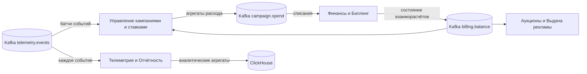

# ADR-003: Источник агрегатов расхода для биллинга — подсистема «Управление кампаниями и ставками»

**Статус**: ✅ Принято

## Контекст

В целевой архитектуре (см. [05-c4-container-to-be.puml](../05-c4-container-to-be.puml)) события показов и кликов поступают в Kafka (топик `telemetry.events`) и потребляются несколькими подсистемами. Подсистема **«Финансы и Биллинг»** (контекст Billing & Finance, см. [03-bounded-contexts.md](../03-bounded-contexts.md)) обязана списывать средства с баланса рекламодателя за **фактические** показы и клики (FR-6 в [02-requirements.md](../02-requirements.md)) и при этом сохранять строгую финансовую согласованность: без «двойных» списаний и без расхождений с лимитами кампаний (атрибут качества P2 «Согласованность данных (финансы)»).

Сырые события телеметрии для биллинга непригодны напрямую: списание выполняется не по каждому событию, а по **агрегированному расходу** — суммам показов/кликов и стоимости в разрезе рекламодателя, кампании и периода. Такая агрегация в целевой картине уже выполняется **дважды**, в двух подсистемах с разными целями:

- **«Управление кампаниями и ставками»** читает `telemetry.events` батчами и суммирует расход по кампаниям, чтобы контролировать **бюджеты и лимиты** (дневные/месячные, остатки). Это агрегаты вида «сколько потрачено по кампании X за период Y».
- **«Телеметрия и Отчётность»** пишет каждое событие в ClickHouse и строит агрегаты для **OLAP-отчётности и аналитики**: разрезы по площадкам, креативам, гео, времени суток, воронки, win-rate и т.п.

Требуется определить, откуда биллинг получает данные для списаний, и не допустить **третьей** реализации одной и той же агрегации внутри самого биллинга.

## Рассмотренные варианты

1. **Биллинг потребляет сырой** `telemetry.events` **и агрегирует сам.** Отклонено: дублирует логику, уже реализованную в подсистеме кампаний; добавляет в ACID-контур поток высокой интенсивности (десятки тысяч событий в секунду), что противоречит принципу «биллинг не должен быть нагружен потоками hot path»; создаёт риск расхождения сумм между лимитами кампаний и фактическими списаниями из-за разных правил округления, дедупликации и окон агрегации.
2. **Биллинг получает агрегаты от подсистемы «Телеметрия и Отчётность».** Отклонено: агрегаты отчётности строятся для аналитических разрезов, а не для расчёта расхода по кампании; их семантика (поздние события, пересчёты, аналитическая дедупликация) ориентирована на аналитику, а не на финансовый учёт. Пришлось бы вводить в отчётный контур отдельный «финансовый» агрегат — то есть снова дублировать работу подсистемы кампаний.
3. **Биллинг списывает по событиям выигрыша аукциона (**`auction.events`**) от подсистемы RTB.** Отклонено: списание происходит за фактические показы/клики, а не за выигранные аукционы; выигрыш не гарантирует показ, поэтому такой источник расходился бы с реальностью и с данными кабинета.
4. **Биллинг получает готовые агрегаты расхода от подсистемы «Управление кампаниями и ставками».** **Принято** — см. ниже.

## Решение

1. **Единственный источник агрегатов расхода для биллинга — подсистема «Управление кампаниями и ставками».** Она публикует в Kafka топик `campaign.spend` с агрегированным расходом (рекламодатель, кампания, период, количество показов/кликов, рассчитанная стоимость, идентификатор батча/окна).
2. **Биллинг не выполняет собственную агрегацию телеметрии** и **не подписывается на** `telemetry.events`. Он потребляет только `campaign.spend`, выполняет списания в своей PostgreSQL в рамках ACID-транзакций и публикует изменения состояния взаиморасчётов в `billing.balance`.
3. **Обоснование выбора источника:** агрегаты, которые подсистема кампаний строит для контроля бюджетов и лимитов, **по смыслу совпадают** с агрегатами, необходимыми для списаний: и там, и там это «фактический расход по кампании за период». Цели тоже совпадают по сути — учёт потраченных денег рекламодателя. Направляя поток именно так, мы делаем агрегацию один раз и гарантируем, что лимиты в кабинете и списания в биллинге опираются на **одни и те же числа**.
4. **Агрегаты подсистемы «Телеметрия и Отчётность» остаются аналитическими** и не используются ни для лимитов, ни для списаний. Две агрегации в системе сохраняются осознанно: они решают разные задачи и имеют разные требования к задержке, полноте и разрезам.
5. **Контракт** `campaign.spend`**:** сообщения идемпотентны (устойчивый ключ окна агрегации: кампания + период + версия батча), чтобы биллинг мог безопасно переобрабатывать сообщения после сбоев без двойных списаний. Биллинг хранит обработанные ключи окон.
6. **Обратная связь:** биллинг публикует `billing.balance`; подсистема кампаний потребляет его для отображения остатка и автоматической остановки кампаний при исчерпании средств, подсистема RTB — для актуализации баланса в Redis.

## Последствия

### Положительные

- Агрегация расхода реализована **один раз**; биллинг избавлен от дублирующей и нагруженной логики обработки потока событий.
- **Согласованность по построению:** лимиты и бюджеты в кабинете и списания в биллинге опираются на один и тот же агрегат — расхождения между «что видит рекламодатель» и «что списано» исключаются на уровне архитектуры.
- Биллинг остаётся компактным ACID-контуром с низкой интенсивностью входящего потока (агрегаты вместо сырых событий), что упрощает обеспечение P2 «Согласованность данных (финансы)».
- Чёткое разделение ответственности агрегаций: кампании — деньги и лимиты, телеметрия — аналитика.

### Отрицательные и компромиссы

- **Связанность:** биллинг зависит от корректности и своевременности агрегации в подсистеме кампаний; сбой или задержка её батч-обработки задерживает списания. Требуются мониторинг лага `campaign.spend` и алерты.
- **Задержка списаний** равна периоду батчевой агрегации плюс задержке доставки; это допустимо для биллинга (списание не на hot path), но ограничивает «мгновенность» баланса — быстрая защита от перерасхода обеспечивается счётчиками в Redis подсистемы RTB, а не биллингом.
- Подсистема кампаний получает дополнительное обязательство — поддерживать **финансово значимый контракт** `campaign.spend` (идемпотентность, версионирование окон, обработка поздних событий), что повышает требования к её тестированию и изменению схемы.
- При появлении новых тарифных моделей (например, оплата за конверсии) правила расчёта стоимости придётся менять в подсистеме кампаний, а не в биллинге; это необходимо учитывать при распределении владения бизнес-правилами ценообразования.

