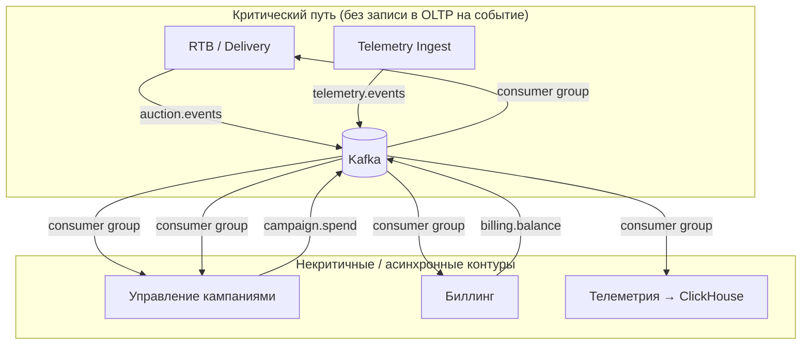

# ADR-004: Выбор брокера сообщений — Apache Kafka

**Статус**: ✅ Принято

## Контекст

Согласно [ADR-001][adr-001], целевая архитектура AdScale декомпозируется по ограниченным контекстам с **событийной интеграцией** между подсистемами. В AS-IS поток показов и кликов и часть межмодульного обмена идут **синхронно в единую PostgreSQL** (драйвер AD-4 в [01-drivers-and-constraints.md]), что конкурирует с OLTP на аукционе и ухудшает latency на hot path (AD-2). Одновременно растёт объём RTB-трафика (AD-1, AD-8): пик ~18 000 RPS сейчас, цель ~50 000 RPS через год; каждый bid и каждый показ/клик порождают события, которые должны обрабатываться **несколькими потребителями** с разной семантикой и задержкой.

Требования к платформе фиксируют:

- **Изоляция критического пути:** перегрузка статистики и аналитики не должна блокировать аукцион (P2 «Надёжность / устойчивость» в [02-requirements.md]).
- **Асинхронная запись событий** вместо синхронной записи в OLTP-БД на hot path (AD-4; см. также [03-bounded-contexts.md] — вынос телеметрии в буфер).
- **Event-driven эволюция** без big bang (AD-6, AD-8, P3 «Модифицируемость»): границы между RTB, кампаниями, биллингом и телеметрией должны выдерживать независимое масштабирование и появление новых подписчиков (например, отчётность, аудит, будущие интеграции).

В целевой C4-диаграмме ([05-c4-container-to-be.puml](../diagrams/05-c4-container-to-be.puml)) уже заложен единый **шина событий** с топиками `telemetry.events`, `auction.events`, `campaign.config`, `campaign.spend`, `billing.balance`. Последующие ADR (в т.ч. [ADR-003][adr-003]) опираются на эту модель. Необходимо явно зафиксировать **технологию брокера** и критерии выбора.

Ограничения эксплуатации: нет выделенного SRE (AD-7, TC-5), на старте нет очередей в production (TC-2) — внедрение брокера должно быть **поэтапным** (сначала разгрузка записи телеметрии, затем межсервисные топики), с управляемой операционной сложностью.

## Рассмотренные варианты

1. **Без отдельного брокера — запись событий только в PostgreSQL (status quo).** Отклонено: не снимает AD-4; hot path и аналитика остаются связаны через одну БД; масштабирование записи событий упирается в primary.
2. **RabbitMQ (classic queues, AMQP).** Отклонено для роли **центральной шины телеметрии и доменных событий**: модель «очередь — сообщение доставлено одному потребителю» плохо соответствует сценарию **множественных независимых подписчиков** на один поток (`telemetry.events` → кампании, телеметрия/ClickHouse, в перспективе другие контуры) без дублирования публикации; ограниченная **ретенция и переигрывание** истории усложняют восстановление после сбоев, бэкфилл и аудит. RabbitMQ остаётся разумным выбором для **точечных task-очередей** (редкие фоновые задания), но не как единый лог высокоинтенсивных событий платформы.
3. **Redis Streams.** Отклонено как основная шина: Redis в целевой архитектуре уже занят **низколатентным состоянием hot path** (лимиты, балансы, кандидаты); смешение роли кэша RTB и durable event log повышает риск потери данных при eviction/сбоях и размывает границы ответственности; объём и срок хранения потока телеметрии не соответствуют профилю in-memory хранилища.
4. **Managed cloud-native стриминг (Yandex Data Streams / аналоги) без явной семантики Kafka.** Допустим как **хостинговая альтернатива** при развёртывании в облаке, но контракты топиков, consumer groups и экосистема клиентов в команде (Go/C++/Python) ориентируются на **Kafka-совместимую модель**; для единообразия ADR фиксирует **Apache Kafka** как логический стандарт, с возможностью managed Kafka / совместимого сервиса как варианта развёртывания.
5. **Apache Kafka (кластер или managed).** **Принято** — см. ниже.

## Решение

1. **Единый брокер сообщений для межконтекстной интеграции и буферизации высокоинтенсивных событий — Apache Kafka** (самостоятельный кластер или managed-аналог с Kafka API).
2. **Паттерн использования:** **event log / pub-sub с consumer groups**, а не классическая «рабочая очередь»:
   - **Producer** на hot path (Telemetry Ingest, RTB) публикует событие и **не ждёт** записи в PostgreSQL/ClickHouse.
   - **Несколько consumer groups** читают один топик независимо (кампании, телеметрия, RTB для актуализации кэша — где применимо).
   - **Партиционирование** по ключу (например, `campaign_id`, `advertiser_id`) для упорядоченности в рамках сущности и горизонтального масштабирования потребителей.
3. **Каталог топиков (целевое состояние)** — согласовано с [05-c4-container-to-be.puml](../diagrams/05-c4-container-to-be.puml):

   | Топик | Назначение | Характер нагрузки |
   |-------|------------|-------------------|
   | `telemetry.events` | Показы, клики и связанные метаданные | Очень высокая запись, несколько подписчиков |
   | `auction.events` | bid / win / no-bid для наблюдаемости и аналитики | Высокая запись |
   | `campaign.config` | Лимиты, бюджеты, правила, шаблоны | Умеренная, компактные сообщения |
   | `campaign.spend` | Агрегаты расхода для биллинга ([ADR-003][adr-003]) | Низкая относительно сырой телеметрии |
   | `billing.balance` | Состояние взаиморасчётов, остатки | Умеренная, финансово значимая |

4. **Граница с синхронным API:** REST/HTTP между подсистемами — только для **некритичных UI-сценариев** (кабинет, админка); обмен состоянием, влияющим на RTB и финансы в пике, идёт через Kafka + локальные материализованные представления (Redis, PostgreSQL подсистемы).
5. **Надёжность и контракты сообщений:**
   - Сериализация: **JSON** или **Protobuf** (единый registry схем по мере зрелости); версионирование полей обратно совместимо.
   - Producers: `acks=all`, идемпотентные producer’ы где поддерживается клиентом.
   - Consumers: явная обработка **at-least-once** с идемпотентностью на стороне приложения (см. окна агрегации в [ADR-003][adr-003]).
   - Retention топиков телеметрии — достаточный для **переигрывания** при сбое consumer’а и ограниченного лага (ориентир: дни, согласуется с SLO отчётности FR-9).
6. **Поэтапное внедрение (strangler), согласованное с AD-6 и TC-2:**
   - **Этап 1:** Telemetry Ingest → `telemetry.events` → consumer в контур телеметрии (ClickHouse), снятие синхронной записи событий с primary PostgreSQL.
   - **Этап 2:** подписчики кампаний и публикация `campaign.config` / `campaign.spend`, `billing.balance`.
   - **Этап 3:** полная событийная связность RTB ↔ кампании ↔ биллинг по целевой диаграмме.
7. **Наблюдаемость:** lag consumer groups, rate in/out по топикам, размер партиций — обязательные метрики (компенсация AD-7, FR-13).

## Последствия

### Положительные

- **Разделение потоков (AD-4):** bid path перестаёт ждать тяжёлую запись статистики; соответствует P2 «перегрузка статистики не блокирует аукцион».
- **Масштабирование:** рост RPS телеметрии поглощается горизонтальным масштабированием ingest и consumer groups, а не только vertical scale PostgreSQL.
- **Множественные подписчики** на один лог без fan-out на уровне приложения — естественная модель для кампаний + аналитики + будущих интеграций (AD-8).
- **Переигрывание и аудит:** retention + offset management упрощают восстановление после сбоев и расследование инцидентов.
- **Единый стандарт интеграции** при декомпозиции монолита (ADR-001): контракт топика вместо скрытых связей через общую БД.

### Отрицательные и компромиссы

- **Операционная сложность:** Kafka требует мониторинга, планирования партиций, capacity planning; при отсутствии SRE целесообразен **managed Kafka** или минимальный кластер с runbook (AD-7).
- **Семантика доставки:** по умолчанию at-least-once — дубли возможны; все финансово значимые consumer’ы обязаны идемпотентность (усиливает требования к [ADR-003][adr-003]).
- **Задержка консистентности:** балансы и лимиты в UI/RTB ** eventual** относительно биллинга; быстрые предохранители остаются в Redis на hot path, а не в Kafka.
- **Стоимость и диск:** высокий объём `telemetry.events` требует политики retention и, при необходимости, tiered storage / отдельного контура compacted топиков для конфигурации.
- **Не заменяет синхронные транзакции** внутри биллинга и кабинета — Kafka не является распределённой СУБД; ACID остаётся в PostgreSQL подсистем.

## Связь с другими решениями

- Реализует принцип «событийно-ориентированная интеграция» из [05-c4-container-to-be.puml](../diagrams/05-c4-container-to-be.puml).
- Является инфраструктурной основой для [ADR-003][adr-003] (топики `campaign.spend`, `billing.balance`).
- Дополняет [ADR-002][adr-002]: read replica снимает OLAP-чтение с primary, Kafka — **запись и распространение** потока событий.

[adr-001]: ADR-001-evolution-strategy.md
[adr-002]: ADR-002-analytics-read-replica.md
[adr-003]: ADR-003-billing-spend-aggregates-source.md
[01-drivers-and-constraints.md]: ../01-drivers-and-constraints.md
[02-requirements.md]: ../02-requirements.md
[03-bounded-contexts.md]: ../03-bounded-contexts.md
