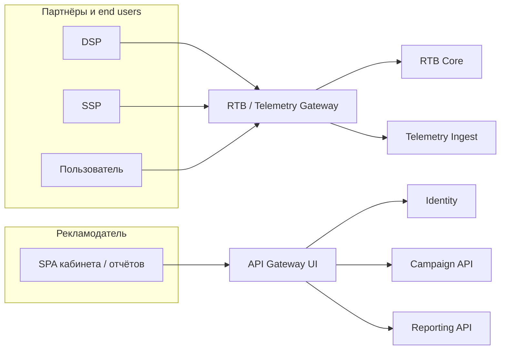

# ADR-005: Два входных шлюза — RTB/Telemetry Gateway и API Gateway (UI)

**Статус**: ✅ Принято

## Контекст

На платформе AdScale одновременно существуют **два принципиально разных класса входящего HTTP-трафика**:

1. **Интеграционный и пользовательский edge (RTB):** bid requests от DSP (OpenRTB), запросы SSP, beacon’ы показов/кликов и загрузка креативов от конечных пользователей. Пик **≥ 18 000 RPS** сейчас, цель **50 000 RPS** (AD-1, AD-8); контрактные **≤ 80 ms** для партнёра и внутренний P95 **≤ 100 ms** (AD-2, BC-4, TC-7). Ошибка или деградация здесь — штрафы и проигрыш аукционов (AD-3).
2. **Трафик рекламодательского кабинета и отчётности:** REST API для SPA, низкий и предсказуемый RPS, допустимы более длинные таймауты, сессии/OIDC, rate limit по пользователю, WAF под браузерный трафик. Сбой не должен влиять на аукцион (P2 «Изоляция сбоев» в [02-requirements.md]).

В AS-IS оба потока часто сходятся в **один веб-контур монолита** и в одну БД — отсюда конкуренция за ресурсы (AD-4) и риск, что тяжёлый запрос кабинета или всплеск beacon’ов ухудшит bid path.

В целевой C4 ([05-c4-container-to-be.puml](../diagrams/05-c4-container-to-be.puml)) на edge явно показаны **два контейнера**:

- **RTB / Telemetry Gateway** — hot path, маршрутизация bid → RTB Core, события → Telemetry Ingest;
- **API Gateway (UI)** — только API кабинета и отчётности, изолирован от RTB.

Распространённое возражение: «два API Gateway — лишняя сложность и каприз архитектора». Ниже зафиксировано, почему это **разделение по профилю нагрузки и blast radius**, а не дублирование одной и той же функции.

## Рассмотренные варианты

1. **Один универсальный API Gateway на весь вход (Kong/Envoy «на всё»).** Отклонено:
   - **Общий пул воркеров и лимитов:** пик телеметрии и RTB конкурируют с запросами кабинета за те же connection/thread limits; при DDoS на beacon’ах или ошибочном релизе WAF-правил страдает и DSP-контракт.
   - **Разные политики безопасности в одной конфигурации:** партнёрский B2B API (mTLS, IP allowlist, подпись, жёсткие body limits под OpenRTB) и браузерный OIDC/JWT с CORS и cookie — один gateway превращается в **монолит конфигурации**, где любое изменение для кабинета рискует затронуть hot path.
   - **Разные SLO по latency:** UI gateway допускает auth hop к Identity и более тяжёлые middleware; RTB gateway должен оставаться **максимально тонким** (TLS termination, routing, минимальная валидация на edge).
2. **Без gateway — прямой доступ к сервисам/монолиту.** Отклонено: нет единой точки TLS, маршрутизации версий и защиты; при декомпозиции (ADR-001) клиентам пришлось бы знать внутреннюю топологию микросервисов.
3. **Два специализированных входных шлюза с разделённой ответственностью.** **Принято** — см. ниже.

Важно: «два gateway» **не означают два одинаковых Kong в HA по 50% трафика**. Это **два разных edge-контура** с разным набором middleware, масштабированием и runbook’ами; технически оба могут быть на базе Nginx/Envoy, но **роли и деплой разделены**.

## Решение

1. **RTB / Telemetry Gateway** (edge hot path):
   - **Клиенты:** DSP, SSP, браузеры/end users (beacon, статика креатива).
   - **Маршрутизация:** bid / ad serving → микросервисы RTB (**HTTP/2 / gRPC**, низкая задержка); показы/клики → **Telemetry Ingest** → Kafka ([ADR-004][adr-004]).
   - **Политики:** минимальная обработка на edge; агрессивные таймауты в сторону RTB; отдельные лимиты RPS; партнёрская аутентификация (TLS, ключи, allowlist — по контракту FR-1, P3 безопасность).
   - **Масштабирование:** горизонтально по метрикам **bid RPS и p99 latency**, независимо от кабинета.

2. **API Gateway (UI)** (edge некритичного синхронного API):
   - **Клиенты:** SPA кабинета и отчётности (рекламодатель).
   - **Маршрутизация:** REST → `campaignServices`, `telemetryServices` (отчёты), интеграция с **Identity** (OIDC/JWT).
   - **Политики:** rate limit per user/tenant, CORS, request size для JSON API, централизованная валидация токенов, опционально WAF для браузерного трафика.
   - **Масштабирование:** по метрикам **ошибок 5xx и latency кабинета**, без привязки к 50k RPS RTB.

3. **Общее:**
   - **Identity** — общий сервис аутентификации для UI-контура; RTB gateway **не** пропускает через него партнёрский OpenRTB (другая модель доверия).
   - **Нет сквозной маршрутизации** «кабинет через RTB gateway» и наоборот — разные DNS/балансировщики (или разные listener’ы с жёсткой сегментацией сети).
   - Событийная интеграция между подсистемами остаётся на **Kafka**, а не через «лишний» hop gateway (согласовано с [ADR-004][adr-004]).

4. **Эволюция (strangler):** на раннем этапе оба шлюза могут быть **логическими** (отдельные virtual host / ingress rules перед монолитом), физически — один Nginx с **изолированными upstream-группами** и лимитами. По мере выделения сервисов те же роли сохраняются; целевое состояние — **отдельные пулы инстансов** под RTB и UI (AD-6, отсутствие big bang).

## Почему это не «лишняя архитектура»

| Вопрос skeptic’а | Ответ |
|------------------|--------|
| «Нельзя ли одним Gateway и сэкономить?» | Экономия одного деплоя мала на фоне штрафов за latency/downtime RTB (BC-4). Цена — **общий fate** при инцидентах и конфигурации. |
| «Это же просто reverse proxy два раза» | Да, по технологии похоже; решение не в количестве продуктов, а в **разделении blast radius и SLO**. Аналогия: отдельный load balancer для CDN и для admin API — нормальная практика. |
| «Усложнит эксплуатацию для команды без SRE» | Два **простых** шаблона конфигурации проще одного «комбайна» с сотней location’ов и взаимными зависимостями; алерты разделены: `rtb_gateway_p99` vs `ui_gateway_5xx`. |
| «Дублирование TLS и маршрутизации» | Намеренный trade-off: **изоляция** важнее минимизации числа VM. Managed LB / один Nginx с двумя изолированными config include — компромисс на старте (п. 4). |

## Последствия

### Положительные

- **Изоляция критического пути (AD-2, P2):** перегрузка или деплой правил UI gateway не блокирует приём bid requests.
- **Независимое масштабирование (AD-1, AD-8):** RTB edge масштабируется под RPS аукциона; UI — под число рекламодателей и отчётов.
- **Чёткие границы безопасности:** B2B OpenRTB и OIDC кабинета не смешиваются в одной цепочке middleware.
- **Соответствие bounded contexts:** RTB Core & Delivery vs Campaign / Telemetry UI — разные клиенты и контракты ([03-bounded-contexts.md](../03-bounded-contexts.md)).
- **Упрощение наблюдаемости (FR-13):** метрики DSP (RPS, latency, no-bid) не размываются HTTP-трафиком кабинета.

### Отрицательные и компромиссы

- Два контура edge — два набора сертификатов, DNS, runbook’ов; при полном физическом разделении — небольшой рост инфраструктурных затрат (приемлемо при BC-2 за счёт managed LB).
- На промежуточном этапе возможна **иллюзия** «один Nginx» — нужна дисциплина: не добавлять в RTB vhost маршруты кабинета «для удобства».
- Партнёры и рекламодатели видят **разные публичные endpoint’ы** — это ожидаемо и документируется в контрактах, а не скрывается за единым `/api`.

## Связь с другими решениями

- Визуализировано в [05-c4-container-to-be.puml](../diagrams/05-c4-container-to-be.puml) (контейнеры `rtbGateway` и `uiGateway`).
- Дополняет [ADR-001][adr-001] (границы при декомпозиции) и [ADR-004][adr-004] (телеметрия с hot path уходит в Ingest/Kafka, а не в UI gateway).
- Не заменяет [ADR-002][adr-002] и event-driven контур: gateway’и — только **синхронный вход**, не шина данных.

[adr-001]: ADR-001-evolution-strategy.md
[adr-002]: ADR-002-analytics-read-replica.md
[adr-004]: ADR-004-message-broker-kafka.md
[01-drivers-and-constraints.md]: ../01-drivers-and-constraints.md
[02-requirements.md]: ../02-requirements.md
[03-bounded-contexts.md]: ../03-bounded-contexts.md
