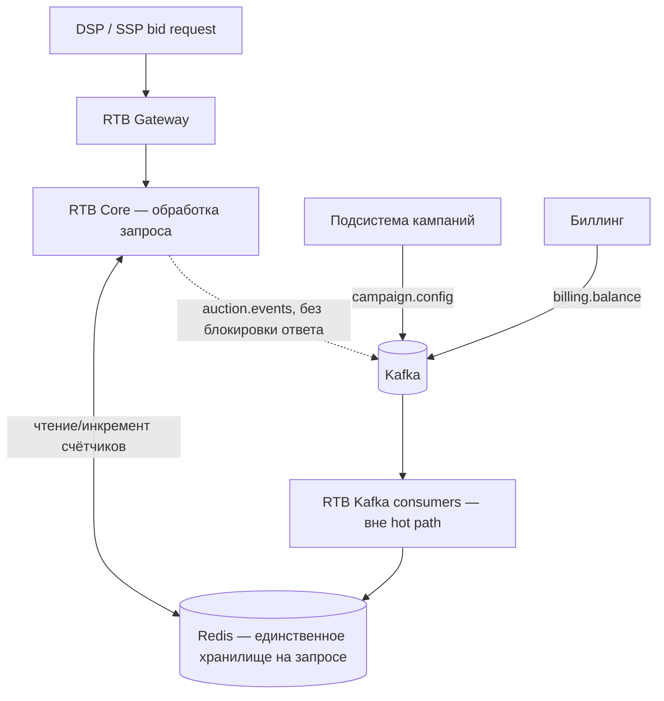

# ADR-006: Hot path RTB — только in-memory кэш (Redis), без SQL и синхронных вызовов соседних подсистем

**Статус**: ✅ Принято

## Контекст

Ограниченный контекст **«Аукционы и Выдача рекламы»** (RTB Core & Delivery) лежит на **критическом пути** каждого bid request: таргетинг, подбор кандидатов, аукцион, формирование ответа партнёру (см. [03-bounded-contexts.md](../03-bounded-contexts.md)). После интеграции с DSP действуют жёсткие ограничения:

- **P95 ≤ 100 ms** (внутренний SLA), для партнёра устойчиво **≤ 80 ms** ([02-requirements.md](../02-requirements.md), P1);
- пик **≥ 18 000 RPS** сейчас, рост до **~50 000 RPS** (AD-1, AD-8 в [01-drivers-and-constraints.md](../01-drivers-and-constraints.md));
- штрафы за latency и downtime (AD-3, BC-4).

В AS-IS Auction Engine выполняет **синхронные обращения к PostgreSQL** (TC-4) — это зафиксированное узкое место: при P95 110–120 ms уже сейчас лимит нарушается (AD-2). Любой сетевой запрос к другой подсистеме или дисковая операция в общей OLTP-БД на пути обработки bid request добавляет **десятки миллисекунд** (вариативность, блокировки, очереди соединений) и при типичном бюджете 80 ms делает контракт с DSP **невыполнимым**.

Целевая C4 ([05-c4-container-to-be.puml](../diagrams/05-c4-container-to-be.puml)) показывает подсистему RTB с **единственным хранилищем на критичном пути — Redis** и актуализацией/дополнением его свежими данными через **Kafka**. Требуется явно зафиксировать архитектурное правило: что допустимо **внутри** обработки запроса, а что вынесено в **асинхронный** контур.

## Рассмотренные варианты

1. **Чтение кампаний, лимитов и балансов из PostgreSQL на каждый bid (status quo / read-through).** Отклонено: конкуренция с телеметрией и аналитикой на одной инстанции (AD-4); непредсказуемая latency; несовместимо с P1 при целевом RPS.
2. **Синхронный REST/gRPC к подсистемам «Кампании» или «Биллинг» во время аукциона** («спросить актуальный бюджет у сервиса кампаний»). Отклонено: каскадные таймауты, зависимость hot path от доступности соседних сервисов, удвоение сетевых hop’ов поверх gateway; нарушает P2 «изоляция сбоев».
3. **Гибрид: Redis + fallback в SQL при промахе кэша.** Отклонено: промах на пике создаёт **хвост latency** (p99/p999), именно по которому партнёры фиксируют нарушения; hot path перестаёт быть детерминированным по задержке.
4. **Все данные для решения по bid request — из локального in-memory слоя (Redis Cluster); изменения из других подсистем — только асинхронно через Kafka.** **Принято** — см. ниже.

## Решение

1. **Правило hot path:** микросервисы подсистемы «Аукционы и Выдача рекламы» при обработке **bid request** и **синхронной выдачи/рендеринга** (в рамках одного запроса к RTB Core) **работают только и исключительно с in-memory кэшем** — **Redis** (кластер, реплицированный). К этому относятся:
  - бизнес-правила торгов и стратегии ставок;
  - справочники кампаний, креативов, таргетинга, шаблоны контента;
  - лимиты, бюджеты, остатки (материализованное представление для торгов);
  - балансы взаиморасчётов, достаточные для защиты от перерасхода на hot path;
  - оперативные счётчики показов/кликов для лимитов в реальном времени (инкременты в Redis).
2. **Запреты на критическом пути обработки bid request:**
  - **нет** обращений к **PostgreSQL** или любой другой **SQL-БД**;
  - **нет** синхронных вызовов **REST/gRPC** к микросервисам подсистем «Управление кампаниями и ставками», «Финансы и Биллинг», «Телеметрия и Отчётность»;
  - **нет** синхронной публикации в Kafka с ожиданием подтверждения, влияющей на время ответа DSP (публикация `auction.events` — **fire-and-forget** после формирования ответа или в отдельном неблокирующем шаге с жёстким локальным таймаутом, не увеличивающим SLA ответа).
3. **Актуализация кэша — только асинхронно:**
  - выделенные **consumer’ы** той же подсистемы RTB (отдельные процессы/пулы, **не** поток обработки bid request) подписаны на топики Kafka ([ADR-004](ADR-004-message-broker-kafka.md)): `campaign.config`, `billing.balance`, при необходимости срезы `telemetry.events` для счётчиков;
  - consumer’ы **атомарно обновляют** соответствующие ключи/структуры в Redis (версионирование конфигурации, чтобы читатель на hot path не видел «полузаписанное» состояние);
  - задержка между изменением в кабинете/биллинге и отражением в Redis — **допустимая eventual consistency**; источником истины для денег и лимитов остаются PostgreSQL соседних подсистем и контракты Kafka, Redis — **операционная проекция для торгов**.
4. **Граница подсистемы по данным:** у подсистемы RTB **нет собственной PostgreSQL**; персистентность долгоживущих сущностей — в других контекстах. Redis для RTB — не «вторичный кэш», а **обязательное рабочее хранилище hot path** с репликацией и персистентностью на уровне кластера (AOF/RDB по политике эксплуатации), чтобы перезапуск не обнулял торговый контур до догрузки из Kafka.
5. **Деградация при устаревшем кэше:** при отсутствии ключей или явно устаревшей версии конфигурации предпочтительны **no-bid / отказ от участия** (FR-5), а не синхронный поход в SQL или соседний сервис. Это осознанный trade-off в пользу SLA latency.

1. **Обоснование по бюджету latency (порядок величин):** при лимите **80 ms** на внешний контракт остаются gateway, парсинг OpenRTB, таргетинг, аукцион и сериализация ответа. Один синхронный SQL-запрос или межсервисный вызов в условиях общей БД и пика RPS легко добавляет **10–50+ ms** к p95 и неограниченный хвост при блокировках — что **математически** вытесняет остальную логику из бюджета и делает P1 недостижимым (AD-2, TC-7).

## Последствия

### Положительные

- Предсказуемая **низкая latency** hot path: только память и локальная сеть до Redis.
- **Изоляция** от перегрузки OLTP, телеметрии и тяжёлых отчётов (AD-4, P2).
- Горизонтальное масштабирование stateless RTB-инстансов при общем Redis/Kafka ([ADR-001](ADR-001-evolution-strategy.md)).
- Согласованность с целевой диаграммой и [readme](../readme.md): RTB без PostgreSQL.

### Отрицательные и компромиссы

- **Eventual consistency:** баланс и лимиты в Redis могут кратковременно отставать от биллинга/кабинета; финально верные суммы — в ACID-контурах кампаний и биллинга ([ADR-003](ADR-003-billing-spend-aggregates-source.md)).
- **Сложность проекции:** версионирование конфигурации, идемпотентные consumer’ы, мониторинг lag Kafka → Redis обязательны (AD-7).
- **Риск рассинхронизации** при сбое consumer’а: нужны алерты, возможность переигрывания offset’ов и warm-up кэша из Kafka.
- **Дублирование данных** (PostgreSQL кампаний + Redis) — осознанная плата за SLA; без дублирования hot path упирается в SQL.

## Связь с другими решениями

- Инфраструктура актуализации: [ADR-004](ADR-004-message-broker-kafka.md) (Kafka).
- Edge не смешивает UI с RTB: [ADR-005](ADR-005-dual-edge-gateway.md).
- Финансовые списания не на hot path: [ADR-003](ADR-003-billing-spend-aggregates-source.md); RTB использует **проекцию** баланса, не вызывает биллинг синхронно.
- Промежуточный шаг эволюции монолита (снятие sync SQL из auction) согласуется с [ADR-001](ADR-001-evolution-strategy.md) и TC-4 как целевое устранение наследуемого антипаттерна.

