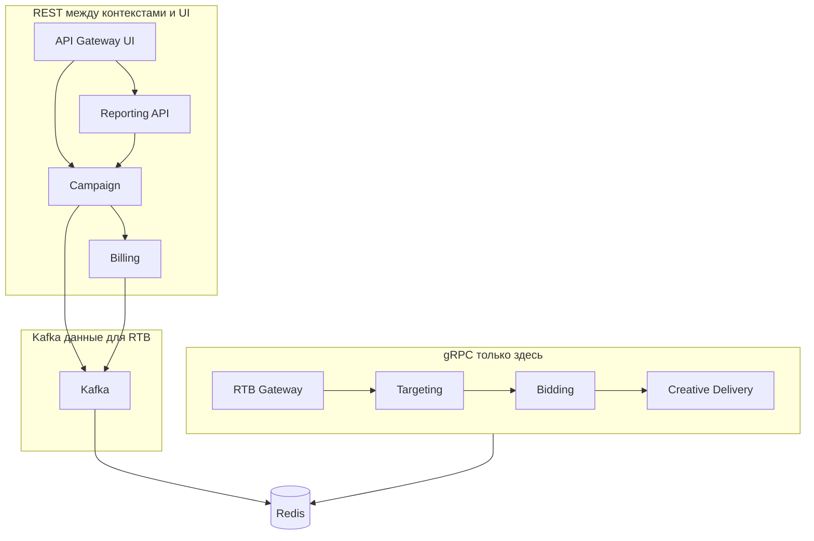

# ADR-007: gRPC только на критическом пути RTB; REST — для всего остального sync

**Статус**: ✅ Принято

## Контекст

На платформе одновременно существуют:

- **Критический путь** bid request: OpenRTB → RTB Gateway → Targeting → Bidding → Creative → Redis, с контрактом **≤ 80 ms** для партнёра и **≥ 18 000 RPS** ([02-requirements.md](../../task1/02-requirements.md), P1).
- **Некритичный sync**: кабинет рекламодателя, отчётность, справочники между back-office сервисами (Campaign, Billing, Telemetry UI), с допустимой latency **сотни ms**.

Команда AdScale **без выделенного SRE** (AD-7): эксплуатация должна опираться на **привычный стек** (HTTP, OpenAPI, curl, браузерные инструменты), а не на два параллельных контура контрактов (.proto + OpenAPI) без необходимости.

На hot path уже зафиксировано: **нет** синхронных вызовов к Campaign/Billing ([ADR-006](../../task1/ADR/ADR-006-rtb-in-memory-hot-path.md)). Остаётся выбор протокола **между компонентами RTB** и **между всеми прочими** сервисами.

## Рассмотренные варианты

1. **gRPC для всех внутренних sync-вызовов** (RTB + Campaign + Billing + Telemetry). Отклонено: выигрыш в latency на back-office ничтожен при их RPS и не имеет смысла. При этом gRPC приведет к росту операционной сложности: codegen, grpc-gateway, отладка, два стандарта контрактов по всей платформе без выгоды вне hot path.
2. **REST на всём, включая RTB hot path** (Gateway → Targeting → Bidding → Creative). Отклонено: при 18k+ RPS каждый hop JSON parse/stringify и менее предсказуемый overhead; при бюджете **~50–60 ms** на цепочку после gateway типичный REST-hop добавляет **+10–30 ms p95** — риск систематического нарушения SLA DSP.
3. **gRPC только на критическом пути RTB; REST для любого другого sync, в том числе между внутренними сервисами.** **Принято** — см. ниже.

## Решение

1. **gRPC применяется только и исключительно** для синхронных вызовов на **критическом пути обработки bid request** (и синхронной выдачи/рендеринга в рамках того же запроса):
  - RTB Gateway → Bid Orchestrator (или эквивалентная цепочка);
  - Targeting ↔ Bidding ↔ Creative Delivery — unary gRPC, проброс **deadline** в metadata.
2. **REST (HTTPS, JSON, OpenAPI)** — **единственный** протокол для **всех остальных** синхронных взаимодействий, **включая вызовы между внутренними сервисами** вне hot path, например:
  - API Gateway (UI) → Campaign / Reporting;
  - Campaign ↔ Billing (данные для кабинета);
  - Telemetry / Reporting ↔ Campaign (справочники);
  - платёжный шлюз, email и прочие B2B HTTP-интеграции.
3. **Данные для RTB из других контекстов — только Kafka.** В bounded context «Аукционы и выдача рекламы» всё, что **влияет на торги** (конфигурация кампаний, лимиты, бюджеты, проекция балансов, оперативные срезы для лимитов и т.д.), поступает из «Кампании», «Биллинга» и смежных контуров **исключительно через Kafka** и материализуется в Redis consumer’ами RTB.
4. **Остальной межконтекстный обмен — REST.** Данные, которые **не участвуют** в принятии решения по bid request в реальном времени (справочники для отчётности, сведения для кабинета, некритичные запросы между Campaign, Billing, Telemetry и внешними системами), **могут и должны** передаваться **синхронно по REST** между сервисами — это основной способ интеграции вне hot path и согласуется с п. 2 настоящего ADR.
5. **Граница «критический путь»:** один логический запрос от приёма OpenRTB bid request до формирования BidResponse (включая `RenderCreative` при положительном решении). Всё, что выполняется **вне** этого запроса (consumers, кабинет, биллинг, OLAP), — **не gRPC**.

### Обоснование gRPC на hot path

| Критерий              | gRPC                 | REST (JSON)                                 |
| --------------------- | -------------------- | ------------------------------------------- |
| Сериализация          | Protobuf, компактнее | JSON parse/stringify на каждом hop          |
| Транспорт             | HTTP/2, multiplexing | HTTP/1.1 или H2 без typed contract          |
| Контракт              | `.proto`, codegen    | OpenAPI                                     |
| Deadline              | Встроен в metadata   | Через headers, менее единообразно           |
| Типичный overhead hop | Низкий при unary RPC | +10–30 ms p95 на 18k+ RPS (порядок величин) |

При бюджете **80 ms** на ответ DSP цепочка Gateway → Targeting → Bidding → Creative оставляет **~50–60 ms** на бизнес-логику и Redis. Синхронный REST к Campaign на этом пути **не рассматривается** (отдельно от протокола — запрет ADR-006): актуальные правила и лимиты — **материализованное представление в Redis**, обновляемое из Kafka.

### Обоснование REST вне hot path

- Низкий RPS, CRUD, пагинация, кэширование HTTP.
- **OIDC/JWT** через API Gateway (UI) — de facto для SPA.
- **Единый стиль сопровождения:** один тип sync-контракта (OpenAPI), знакомый стек команды, проще онбординг и поддержка без gRPC-инфраструктуры на каждом сервисе.

**Вывод:** gRPC — только RTB critical path; **Kafka** — в RTB-контур всё, что влияет на торги из других контекстов; **REST** — прочий sync между контекстами и UI.

## Последствия

### Положительные

- SLA DSP достижим за счёт минимального overhead на единственной gRPC-цепочке.
- **Упрощение сопровождения:** одна технология sync вне RTB (REST/OpenAPI).
- Чёткое правило для ревью: gRPC — только bid critical path; **Kafka** — данные, влияющие на RTB, из других контекстов; **REST** — прочий sync между контекстами.

### Отрицательные и компромиссы

- На hot path команда поддерживает **отдельный** контракт (.proto) и tooling gRPC — осознанная плата за latency.
- REST между internal сервисами не даёт такой же типизации, как protobuf — компенсируется OpenAPI, контрактными тестами и умеренным RPS.
- Нельзя «оптимизировать» back-office вызов gRPC без пересмотра ADR.

