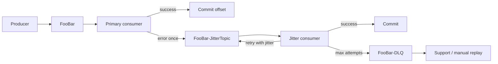

# ADR-008: At-least-once для Kafka через JitterTopic и DLQ без блокировки основной очереди

**Статус**: ✅ Принято

## Контекст

Фоновые потребители Kafka (Cache Projector, Billing, телеметрия/OLAP) работают в семантике **at-least-once**: повторная доставка после сбоя — **нормальный** сценарий, обработчик обязан быть **идемпотентным**.

Одновременно:

- **Сбой одного сообщения не должен останавливать** обработку остальных записей в партиции (нет head-of-line blocking на основном топике).
- Нужны **контролируемые повторы**, чтобы при массовой деградации downstream (БД, Redis, внешний API) не возник «шторм» синхронных ретраев по всему кластеру.
- После исчерпания попыток сообщение должно **сохраниться** для ручного разбора поддержкой, а не «тихо» теряться.

Hot path RTB и sync bid request **не входят** в область настоящего ADR (там — no-bid, circuit breaker, без retry; см. [interaction.md](../interaction.md) §7.2).

## Рассмотренные варианты

1. **Retry с exponential backoff в том же consumer group основного топика.** Отклонено: пока поток «спит» на одной записи, **партиция не продвигается** — одна «ядовитая» или временно неуспешная запись **блокирует** всю партицию и увеличивает lag для здоровых сообщений.
2. **Бесконечный retry в primary consumer без commit offset.** Отклонено: тот же head-of-line blocking; at-least-once не компенсирует простой очереди.
3. **Commit и discard (skip) после ошибки.** Отклонено: нарушает бизнес-ожидание at-least-once: сообщение может быть **потеряно** без следа для поддержки.
4. **Пара топиков на каждый бизнес-топик: primary + `{Topic}-JitterTopic` + `{Topic}-DLQ`.** **Принято** — см. ниже.

## Решение

### 1. Именование и состав топиков

Для каждого **бизнес-топика** `FooBar` (например `campaign.config`, `billing.balance`, `campaign.spend`, `telemetry.events`) вводятся **два технических топика**:

| Топик | Роль |
|-------|------|
| `FooBar` | Основной поток; **быстрая** обработка «в один проход» |
| `FooBar-JitterTopic` | Отложенные повторы с **случайными паузами** между попытками |
| `FooBar-DLQ` | Dead Letter Queue — сообщения после исчерпания лимита попыток для анализа поддержкой |

Схема payload **одинакова** на всех трёх топиках; метаданные повтора передаются в **обёртке** (envelope) или заголовках Kafka.

### 2. Primary consumer (`FooBar`)

- Обрабатывает каждое сообщение **ровно одну попытку** в рамках одного poll-цикла (без sleep/backoff на партиции).
- При **успехе**: commit offset (или batch commit по политике группы).
- При **исключении** (transient или unknown): **не** блокирует партицию повторами; **публикует** копию сообщения в `FooBar-JitterTopic` с заголовками:
  - `retry_attempt = 0` (или 1 — зафиксировать в коде единообразно);
  - `original_topic`, `original_partition`, `original_offset`;
  - `first_failure_at`, `last_error` (краткий код/тип, без секретов);
  - сохраняется бизнес-ключ (`event_id`, `transaction_id` и т.д.) для идемпотентности.
- Commit offset основного сообщения выполняется **только после** успешной публикации в `FooBar-JitterTopic` (или идемпотентной повторной публикации). Так сохраняется **at-least-once**: либо обработано, либо гарантированно попало в контур повторов.

Primary consumer **не** выполняет exponential backoff.

### 3. Jitter consumer (`FooBar-JitterTopic`)

- Отдельная **consumer group**, масштабируется независимо от primary.
- Для каждого сообщения допускается **несколько попыток** обработки (ориентир **5–7**, настраивается per топик).
- Между попытками — **случайная задержка (jitter)** в заданном диапазоне (например base **1–30 s**, с ростом верхней границы по номеру попытки — «мягкий» exponential через max delay, без синхронизации всех консьюмеров).
- Обработчик **идемпотентен** (dedup по `event_id` / `transaction_id`, см. §7.3 [interaction.md](../interaction.md)).
- При успехе — commit offset в JitterTopic.
- При ошибке и **не исчерпан** лимит: re-publish в тот же `FooBar-JitterTopic` с увеличенным `retry_attempt` **после** jitter (или sleep в worker pool **вне** блокировки poll основной партиции primary — jitter-консьюмер может использовать bounded worker + delayed requeue через повторную публикацию).
- При **исчерпании** лимита — публикация в `FooBar-DLQ` с полным контекстом ошибок, затем commit в JitterTopic.

Jitter-консьюмер **не** читает основной топик; primary **не** читает JitterTopic/DLQ.

### 4. DLQ и поддержка

- Сообщения в `FooBar-DLQ` **не обрабатываются** автоматически бизнес-логикой.
- Алерт по rate в DLQ и dashboard для поддержки (FR-13).
- После исправления причины — **ручной replay** (скрипт/админ-tool) из DLQ обратно в `FooBar` или в `FooBar-JitterTopic` с обнулением счётчика попыток.

### 5. Классификация ошибок (рекомендация)

| Тип | Primary | Jitter | DLQ |
|-----|---------|--------|-----|
| Transient (timeout, 503, deadlock) | → JitterTopic | retry + jitter | после лимита |
| Poison (невалидная схема, нарушение инварианта) | → JitterTopic *или* сразу DLQ при детекте | 1–2 попытки | быстрый вывод в DLQ |
| Duplicate (идемпотентный no-op) | success, commit | — | — |

Ядовитые сообщения можно **коротко** пропускать через Jitter (1 попытка), чтобы не тратить слот primary на бесконечные циклы — политика фиксируется в runbook топика.

### 6. Связь с идемпотентностью

At-least-once + перекладка между топиками означает **дубликаты** на всех этапах. Обязательны:

- стабильный **`event_id` / `transaction_id`** в payload;
- dedup в consumer (Redis/PostgreSQL `ON CONFLICT DO NOTHING`, см. [interaction.md](../interaction.md) §7.3).

## Последствия

### Положительные

- Основной топик **не блокируется** длительными retry одной записи; lag отражает реальный объём работы, а не «залипание» на poison message.
- Сохраняется **at-least-once** за счёт republish + commit только после успешной перекладки.
- Jitter **размазывает** нагрузку повторов при инцидентах.
- DLQ даёт **аудируемую** точку для поддержки без потери данных.

### Отрицательные и компромиссы

- **Три топика** на каждый бизнес-поток: больше партиций, мониторинга и retention-политик.
- Дубликаты и **out-of-order** между primary и jitter-потоком возможны — компенсируется идемпотентностью и версионированием проекций (Redis/CQRS).
- Republish увеличивает **write amplification** на брокере при массовых сбоях — приемлемо для фонового контура относительно hot path.
- Ручной replay из DLQ требует **runbook** и инструментов (AD-7: нет выделенного SRE — документировать явно).
