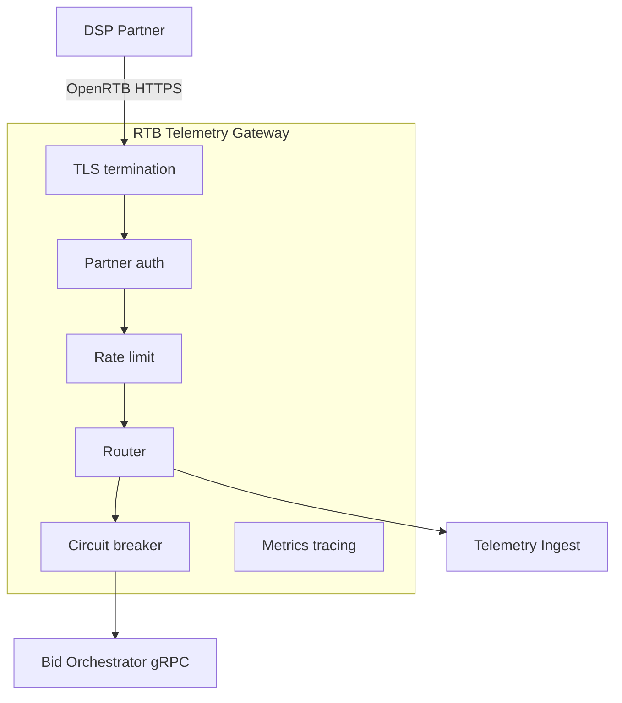

# RTB / Telemetry Gateway — API-слой интеграции с DSP

Специализированный **входной шлюз hot path** для bid requests от DSP и (отдельным маршрутом) приёма событий телеметрии. Это **не** API Gateway рекламодательского кабинета ([ADR-005](../task1/ADR/ADR-005-dual-edge-gateway.md)).

Связанные документы: [bidding-service.md](bidding-service.md), [interaction.md](interaction.md).

---

## 1. Роль в архитектуре

| Функция                | Описание                                            |
|------------------------|-----------------------------------------------------|
| Единая точка входа DSP | Публичный HTTPS endpoint, версионирование контракта |
| Тонкий edge            | Минимум логики; тяжёлый аукцион — в RTB services    |
| Изоляция               | Отдельный deployment/pool от UI Gateway             |
| Безопасность B2B       | mTLS / API keys, IP allowlist — без OIDC кабинета   |

**Технология (рекомендация):** Envoy или Nginx с gRPC upstream; фильтры rate limit и outlier detection.

---

## 2. Маршрутизация

### 2.1 Маршруты bid path

| Маршрут                           | Метод | Upstream                           | Назначение                |
|-----------------------------------|-------|------------------------------------|---------------------------|
| `/openrtb2/bid`                   | POST  | Bid Orchestrator cluster           | Стандарт OpenRTB 2.x      |
| `/partners/{dsp_id}/openrtb2/bid` | POST  | Partner-specific cluster / weights | Изоляция партнёра, canary |
| `/health`, `/ready`               | GET   | Local                              | K8s / LB probes           |

**Правила:**

- **Host-based routing:** `rtb.adscale.example.com` — только RTB; UI на другом DNS.
- **Версия протокола:** header `x-openrtb-version: 2.5` или path `/v2.5/...`.
- **Canary (FR-14):** weighted cluster — например 5% трафика нового DSP на `rtb-v2` upstream по header `x-adscale-canary: 1` или проценту на `dsp_id`.

### 2.2 Bid Orchestrator

Лёгкий stateless сервис (или embedded в gateway worker) выполняет:

1. OpenRTB JSON → protobuf `GetCandidates` / `EvaluateBid` / `RenderCreative`.
2. Проброс **deadline** в gRPC (`grpc-timeout` / context).
3. Protobuf → OpenRTB BidResponse.

### 2.3 Маршрут telemetry (тот же gateway, другой pool)

| Маршрут                                         | Upstream         | Примечание                                                                                            |
|-------------------------------------------------|------------------|-------------------------------------------------------------------------------------------------------|
| `/imp`, `/click`, `/winnotice`                  | Telemetry Ingest | Быстрый 204/1x1 gif; **без** RTB services                                                             |
| Отдельный **rate limit** и **connection limit** | —                | Шторм событий телеметрии не влияет на bid pool ([ADR-005](../task1/ADR/ADR-005-dual-edge-gateway.md)) |

---

## 3. Ограничение частоты запросов (Rate Limiting)

### 3.1 Политики

| Уровень              | Алгоритм     | Лимит (пример)                              |
|----------------------|--------------|---------------------------------------------|
| Per `dsp_partner_id` | Token bucket | Контракт: 20 000 RPS burst 22 000           |
| Global cluster       | Token bucket | Защита инфраструктуры: 25 000 RPS           |
| Per source IP        | Leaky bucket | Anti-abuse: 500 RPS / IP (поверх allowlist) |

Идентификация партнёра: mTLS SAN, API key header `Authorization: Bearer <key>`, mapping key → `dsp_partner_id`.

### 3.2 Ответ при превышении

- HTTP **429** с `Retry-After`, **или**
- HTTP **200** с пустым `seatbid` / `nbr` (если так зафиксировано в контракте DSP).

Предпочтительно согласовать с партнёром **no-bid response** вместо 429 на bid path, чтобы не ломать OpenRTB клиент.

---

## 4. Аутентификация и авторизация

| Механизм            | Применение                                         |
|---------------------|----------------------------------------------------|
| **TLS 1.2+**        | Обязательно для всех партнёров                     |
| **mTLS**            | Клиентский сертификат DSP → `dsp_partner_id` в SAN |
| **API Key**         | Header + rotation через secret store               |
| **IP allowlist**    | CIDR партнёра на edge firewall / Envoy RBAC        |
| **Body size limit** | Например 256 KB — защита от oversized OpenRTB      |

**Не используется на RTB gateway:** OIDC, JWT кабинета, CORS для браузера (события телеметрии — отдельные политики, без смешения с bid middleware).

Audit log: `dsp_partner_id`, `request_id`, timestamp, result code — без ПДн в логах edge.

---

## 5. Circuit Breaker и таймауты

### 5.1 Upstream circuit breaker

Настройка на cluster **Bid Orchestrator** (Envoy outlier detection / `max_connections` + health):

| Параметр                     | Значение (ориентир) |
|------------------------------|---------------------|
| Consecutive 5xx              | 5 → eject host      |
| Consecutive gateway failures | 3                   |
| Ejection time                | 30 s                |
| Max ejection percent         | 50%                 |

**Состояние open (логическое):** при недоступности всех upstream — gateway **не ждёт** полный `tmax`; возвращает **no-bid** за **≤ 5 ms** (fast-fail).

### 5.2 Таймауты и бюджет SLA

| Этап                            | Timeout                                 |
|---------------------------------|-----------------------------------------|
| Полный запрос DSP → Gateway     | ≤ partner `tmax` (80 ms)                |
| Overhead edge (TLS, parse, route) | **5 ms** (p95, в обе стороны)         |
| Gateway → upstream gRPC         | **70 ms** (буфер на TLS и сериализацию) |
| Bid Orchestrator + сеть         | 5 ms                                    |
| Targeting                       | 20 ms (budget)                          |
| Bidding                         | 35 ms                                   |
| Creative                        | 10 ms                                   |

**Сходимость бюджета:** 5 (orchestrator) + 20 + 35 + 10 = **70 ms** внутри deadline upstream; вместе с edge overhead — **75 ms** при лимите партнёра **80 ms**, запас **5 ms** на jitter и очереди.

Сумма budgets контролируется orchestrator; при нехватке — early **no-bid**.

### 5.3 Retry на gateway

**Нет** автоматического retry POST bid на другой инстанс — риск двойного аукциона. Только **retry на другой host** при idempotent **GET** health. Bid — single attempt + CB.

---

## 6. Мониторинг времени отклика

### 6.1 Метрики (Prometheus / аналог)

| Метрика                                      | Labels                                                   |
|----------------------------------------------|----------------------------------------------------------|
| `rtb_gateway_request_duration_seconds`       | histogram, `dsp_partner_id`, `route`, `status`           |
| `rtb_gateway_requests_total`                 | counter, `dsp_partner_id`, `result` (bid\|no_bid\|error) |
| `rtb_gateway_rate_limit_dropped_total`       | `dsp_partner_id`                                         |
| `rtb_gateway_circuit_breaker_open`           | gauge per cluster                                        |
| `rtb_gateway_upstream_grpc_duration_seconds` | `method`                                                 |

**SLO alerts:** p95 > **75 ms** 5 min; error rate > 0.1%; CB open > 1 min.

### 6.2 Трассировка

- Вход: OpenRTB `id` → `X-Request-Id` + W3C **traceparent**.
- gRPC metadata: `x-request-id`, `x-dsp-partner-id`, trace context.
- Сквозная trace: Gateway → Targeting → Bidding → Creative (FR-13).

### 6.3 Логирование

Structured JSON: `request_id`, `dsp_partner_id`, `duration_ms`, `decision`, `nbr`, `upstream_status` — sampling 1–10% на успех, 100% на ошибки.

---

## 7. Нефункциональные требования gateway

| Атрибут                | Цель                                                            |
|------------------------|-----------------------------------------------------------------|
| Пропускная способность | ≥ **18 000 RPS** bid (горизонтальное масштабирование реплик)    |
| Latency overhead edge  | p95 **≤ 5 ms** (TLS + parse + route)                            |
| Availability           | Независимость от UI Gateway; multi-AZ                           |
| Конфигурация           | GitOps / declarative; **запрет** маршрутов кабинета в RTB vhost |

---

## 8. Связь с Bidding Service

Gateway **не** реализует логику ставок. Контракт downstream — gRPC к Bid Orchestrator, далее [BiddingService.EvaluateBid](bidding-service.md#22-внутренний-grpc-hot-path). OpenRTB `seatbid` собирается из ответов Bidding и Creative.

При деградации см. [interaction.md — fallback](interaction.md#74-резервные-стратегии-fallback).
