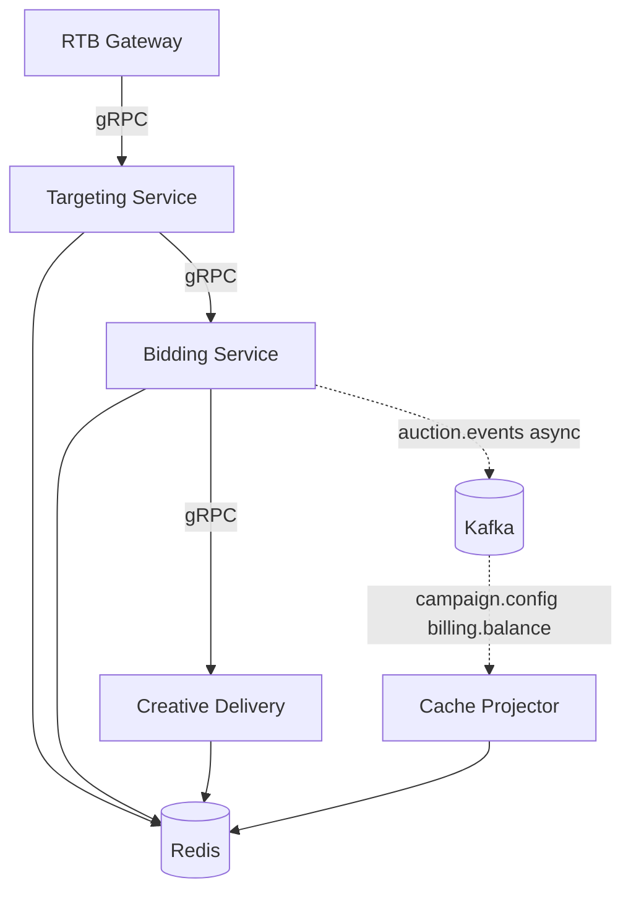

# Bidding Service — спецификация сервиса ставок

Сервис ставок выделяется из **Auction Engine** монолита AdScale и входит в подсистему «Аукционы и Выдача рекламы» (RTB Core). Отвечает за применение бизнес-правил торгов, проверку лимитов по оперативной проекции и формирование решения **bid / no-bid** в бюджете latency партнёра DSP.

Связанные документы: [interaction.md](interaction.md), [api-gateway.md](api-gateway.md), [Task 1 — ADR-006](../task1/ADR/ADR-006-rtb-in-memory-hot-path.md).

---

## 1. Границы и ответственность

### In scope

| Обязанность           | Описание                                                                                       |
|-----------------------|------------------------------------------------------------------------------------------------|
| Оценка аукциона       | Приём контекста запроса и списка **кандидатов** (line items / creatives), прошедших таргетинг  |
| Стратегии ставок      | Base bid, modifiers, floor/reserve, deal/priority rules — по данным из **Redis**               |
| Лимиты и pacing       | Проверка дневных/общих бюджетов, caps показов/кликов, проекция баланса рекламодателя           |
| Решение               | Выбор победителя (internal auction), **price** для OpenRTB, идентификаторы креатива            |
| Оперативное состояние | Атомарные **резервы/инкременты** счётчиков в Redis на hot path (не финальное ACID-списание)    |
| Наблюдаемость         | Асинхронная публикация в Kafka `auction.events` (bid / win / no-bid) после формирования ответа |

### Контекстная диаграмма (логическая)

---

## 2. API

### 2.1 Внешний контракт (DSP)

DSP **не** вызывает Bidding Service напрямую. Контракт — **HTTPS + OpenRTB 2.x** на RTB Gateway ([api-gateway.md](api-gateway.md)).

| OpenRTB (вход)                   | Использование в RTB                                     |
|----------------------------------|---------------------------------------------------------|
| `id`                             | `request_id`, трассировка, идемпотентность              |
| `imp[]`                          | Формат, размер, bidfloor, deal ids                      |
| `site` / `app`, `device`, `user` | Контекст для Targeting                                  |
| `tmax`                           | Верхняя граница; gateway выставляет внутренний deadline |

| OpenRTB (выход)                         | Источник                               |
|-----------------------------------------|----------------------------------------|
| `seatbid[].bid[].price`                 | Bidding Service                        |
| `seatbid[].bid[].adm` / `nurl` / `crid` | Creative Delivery + метаданные Bidding |
| Пустой `seatbid` / `nbr`                | no-bid (FR-5)                          |

### 2.2 Внутренний gRPC (hot path)

**Сервис:** `adscale.rtb.v1.BiddingService`

#### RPC `EvaluateBid`

Unary, deadline наследуется от gateway (ориентир **≤ 35 ms** на Bidding + Redis).

**EvaluateBidRequest (основные поля):**

| Поле             | Тип                | Описание                                                                                 |
|------------------|--------------------|------------------------------------------------------------------------------------------|
| `request_id`     | string             | OpenRTB `id`, ключ идемпотентности                                                       |
| `dsp_partner_id` | string             | Идентификатор DSP-партнёра                                                               |
| `auction_type`   | enum               | first_price / second_price (по контракту)                                                |
| `context`        | message            | geo, device, imp, regs, schain (уже нормализовано gateway)                               |
| `candidates`     | repeated Candidate | Список от Targeting: `campaign_id`, `line_item_id`, `creative_id`, `priority`, `deal_id` |
| `deadline_ms`    | int32              | Абсолютный дедлайн обработки (Unix ms или remaining budget)                              |
| `trace_context`  | map                | W3C traceparent для observability                                                        |

**EvaluateBidResponse:**

| Поле                          | Тип    | Описание                                          |
|-------------------------------|--------|---------------------------------------------------|
| `decision`                    | enum   | `BID` \| `NO_BID`                                 |
| `price_micros`                | int64  | Ставка в микро-единицах валюты                    |
| `winning_campaign_id`         | string | Победитель internal auction                       |
| `line_item_id`, `creative_id` | string | Для Creative Delivery                             |
| `deal_id`                     | string | Если применимо                                    |
| `nbr`                         | int32  | OpenRTB no-bid reason code                        |
| `config_version`              | int64  | Версия проекции Redis, использованная при решении |

#### RPC `GetBidDecision` (опционально, кэш идемпотентности)

Для повторного `request_id` в окне dedup (например 60 s) — вернуть сохранённый результат без повторного аукциона.

**Targeting Service** (соседний контракт, для полноты границ):

- `GetCandidates(GetCandidatesRequest) → GetCandidatesResponse` — чтение индекса и правил из Redis, фильтрация по контексту.

**Creative Delivery:**

- `RenderCreative(RenderRequest) → RenderResponse` — markup/adm при `decision = BID`.

Orchestration: gateway или лёгкий **Bid Orchestrator** (stateless) вызывает цепочку Targeting → Bidding → Creative в одном запросе; Bidding не парсит HTTP.

### 2.3 Асинхронные контракты

| Направление         | Топик                                | Семантика                                                                                      |
|---------------------|--------------------------------------|------------------------------------------------------------------------------------------------|
| Bidding → платформа | `auction.events`                     | `event_id`, `request_id`, `type` (bid\|win\|no_bid), price, ids, `timestamp`, `config_version` |
| Платформа → Redis   | `campaign.config`, `billing.balance` | Consumer **Cache Projector**, не поток `EvaluateBid`                                           |

Публикация `auction.events` — **fire-and-forget** с локальным таймаутом (например 5 ms); при неудаче — метрика и буфер, **без** задержки ответа DSP ([ADR-006](../task1/ADR/ADR-006-rtb-in-memory-hot-path.md)).

---

## 3. Зависимости

| Зависимость                  | Тип связи              | На hot path?  | Примечание                          |
|------------------------------|------------------------|---------------|-------------------------------------|
| **Redis Cluster**            | read/write             | да            | Единственное хранилище на запросе   |
| **Targeting Service**        | gRPC sync              | да            | Короткий hop; общий SLA с Bidding   |
| **Creative Delivery**        | gRPC sync              | да            | Только при успешном bid             |
| **Kafka**                    | async producer         | нет           | `auction.events`                    |
| **Cache Projector**          | Kafka consumer → Redis | нет           | Отдельный deployment                |
| Campaign PostgreSQL          | —                      | **запрещено** | Только через Kafka-проекцию         |
| Billing PostgreSQL           | —                      | **запрещено** | Баланс — проекция `billing.balance` |
| REST/gRPC к Campaign/Billing | —                      | **запрещено** | ADR-006                             |

**SLO сервиса:** P95 обработки `EvaluateBid` (без gateway) **≤ 35 ms** при P95 Redis **≤ 5 ms** — бюджет Bidding в цепочке orchestrator 5 + Targeting 20 + Bidding 35 + Creative 10 = 70 ms, что с edge overhead 5 ms укладывается в **≤ 80 ms** end-to-end ([api-gateway.md §5.2](api-gateway.md#52-таймауты-и-бюджет-sla)).

---

## 4. Модель данных (Redis)

Redis — **рабочая проекция** для торгов, не source of truth для денег и кампаний. Источник истины — PostgreSQL соседних подсистем + события Kafka.

### 4.1 Ключи и структуры

| Ключ / паттерн                      | Тип           | Содержание                                                                                                         |
|-------------------------------------|---------------|--------------------------------------------------------------------------------------------------------------------|
| `campaign:{id}:meta`                | Hash          | `status`, `advertiser_id`, `formats[]`, `paused`                                                                   |
| `campaign:{id}:bid_rules`           | Hash          | `strategy`, `base_bid_micros`, `max_bid_micros`, `floor_micros`, `modifiers_json`                                  |
| `campaign:{id}:limits`              | Hash          | `daily_budget_micros`, `total_budget_micros`, `daily_remaining`, `total_remaining`, `imp_cap_day`, `click_cap_day` |
| `advertiser:{id}:balance`           | String / Hash | `available_micros`, `hold_micros`, `as_of_version`                                                                 |
| `campaign:{id}:counters:{yyyyMMdd}` | Hash          | `imps`, `clicks`, `spend_micros` (HINCRBY на hot path)                                                             |
| `idx:candidates:{segment}`          | Set / ZSet    | Быстрый список `line_item_id` для Targeting                                                                        |
| `line_item:{id}:creative`           | Hash          | `creative_id`, `template_ref`, `audit_status`                                                                      |
| `config:version`                    | String        | Глобальный монотонный номер релиза проекции                                                                        |
| `campaign:{id}:config_version`      | String        | Версия последнего успешного swap для кампании                                                                      |
| `bid:dedup:{request_id}`            | String + TTL  | Сериализованный `EvaluateBidResponse` (идемпотентность)                                                            |

### 4.2 Версионирование и atomic swap

Consumer **Cache Projector** при обновлении из `campaign.config`:

1. Пишет новые поля во **временные** ключи `campaign:{id}:bid_rules:next` или новый hash с суффиксом версии.
2. Выполняет **RENAME** / Lua-script: swap `bid_rules` и `limits` атомарно, инкремент `campaign:{id}:config_version`.
3. Bidding при чтении сравнивает `config_version` с порогом «свежести»; при lag > N секунд — **no-bid** (FR-5), не поход в SQL.

### 4.3 Операции на hot path

| Операция                               | Когда                | Механизм                                                |
|----------------------------------------|----------------------|---------------------------------------------------------|
| Чтение правил и лимитов                | Каждый `EvaluateBid` | MGET / pipeline                                         |
| Проверка бюджета                       | Перед bid            | `daily_remaining >= price`, balance projection          |
| Резерв при bid                         | После выбора цены    | Lua: decrement remaining + increment hold (best-effort) |
| Инкремент imps (win notification path) | По политике          | Может быть на win-событиях; счётчики для caps — HINCRBY   |

Финальное списание — асинхронно: телеметрия → агрегаты кампаний → `campaign.spend` → Billing ([ADR-003](../task1/ADR/ADR-003-billing-spend-aggregates-source.md)).

---

## 5. Надёжность (кратко)

Детали: [interaction.md — паттерны надёжности](interaction.md#7-паттерны-надёжности).

| Ситуация                                 | Поведение                                                                                                                   |
|------------------------------------------|-----------------------------------------------------------------------------------------------------------------------------|
| Нет ключей / устаревшая `config_version` | **no-bid**, `nbr` = invalid configuration                                                                                   |
| Недостаточный balance projection         | **no-bid**, не синхронный вызов Billing                                                                                     |
| Повтор `request_id` от DSP               | Ответ из `bid:dedup:{request_id}`                                                                                           |
| Допустимый fallback                      | Консервативная **cached** стратегия только если ключ помечен `fallback_valid=true` и floor не нарушает лимиты; иначе no-bid |
| Сбой Kafka producer                      | Ответ DSP не задерживается; событие в локальный retry buffer                                                                |

---

## 6. Нефункциональные требования

| Атрибут         | Цель                                                           |
|-----------------|----------------------------------------------------------------|
| Масштабирование | Stateless инстансы Bidding; горизонтально по CPU/latency       |
| RPS             | Совместно с Targeting/Creative — **≥ 18 000** bid RPS в пик    |
| Изоляция        | Сбой Kafka consumers / отчётности не блокирует `EvaluateBid`   |
| Безопасность    | Нет публичного HTTP API; только mTLS/gRPC mesh внутри кластера |
