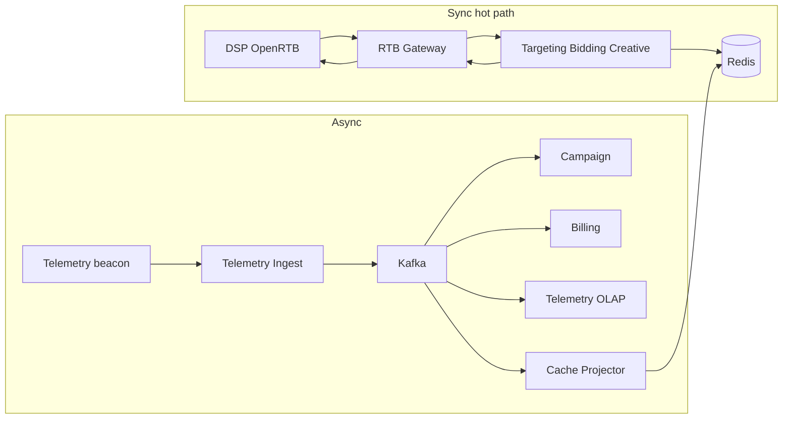

# Взаимодействие компонентов RTB и обоснование протоколов

## 1. Обзор потоков

---

## 2. Матрица взаимодействий

| Связь | Протокол | Паттерн | Критичность |
|-------|----------|---------|-------------|
| DSP ↔ AdScale | **HTTPS**, OpenRTB 2.x (JSON) | Sync request/response | P1, FR-1 |
| RTB Gateway ↔ RTB services | **gRPC** over HTTP/2 | Sync, unary RPC, deadline propagation | P1 |
| Targeting ↔ Bidding ↔ Creative | **gRPC** | Sync, in-subsystem chain | P1 |
| Bidding ↔ Redis | Redis protocol | Sync pipeline / Lua | P1 |
| Рекламодатель ↔ Campaign API | **REST** via API Gateway (UI) | Sync, OIDC | Некритично |
| Campaign ↔ Billing (кабинет) | REST | Sync | Некритично |
| Показы / клики | HTTP → Ingest → **Kafka** `telemetry.events` | Async, at-least-once | Высокая запись, не блокирует bid |
| Конфиг кампаний | **Kafka** `campaign.config` → consumer → Redis | Async CQRS projection | Eventual consistency |
| Балансы | **Kafka** `billing.balance` → consumer → Redis | Async projection | Eventual consistency |
| Исход аукциона | **Kafka** `auction.events` | Async fire-and-forget | FR-13, аналитика |
| Списание | **Kafka** `campaign.spend` → Billing | Async, идемпотентный consumer | P2 финансы |

---

## 3. gRPC vs REST

Выбор протоколов для sync-вызовов зафиксирован в **[ADR-007](ADR/ADR-007-grpc-critical-path-rest-elsewhere.md)**: gRPC **только** на критическом пути RTB (bid request); **REST** — для всего остального sync, в том числе между внутренними сервисами вне hot path.

---

## 4. Kafka для событий

Обоснование выбора Kafka для телеметрии, конфигурации, аукциона и межконтекстной интеграции — **[ADR-004](../task1/ADR/ADR-004-message-broker-kafka.md)** (топики, fan-out, изоляция hot path, at-least-once).

---

## 5. API Gateway

Разделение edge-контуров (RTB / Telemetry Gateway vs API Gateway UI), обоснование и последствия — **[ADR-005](../task1/ADR/ADR-005-dual-edge-gateway.md)**. Детальный дизайн RTB Gateway для DSP — [api-gateway.md](api-gateway.md).

---

## 6. Сценарий: bid request от DSP

Партнёрская DSP отправляет на AdScale **HTTPS-запрос** с телом в формате OpenRTB: в нём описаны показ, контекст пользователя и площадки, а также **максимальное время ожидания** (`tmax`, обычно около 80 ms). Запрос попадает не в кабинет и не в общий UI Gateway, а в **RTB Gateway** — тонкий входной слой для интеграций.

На edge шлюз **проверяет партнёра** (TLS, ключ или сертификат), **не допускает перегрузки** rate limit’ом и разбирает JSON. Для трассировки используется идентификатор запроса из OpenRTB; дальше по цепочке передаётся **жёсткий дедлайн** (ориентир ~70 ms на всю внутреннюю обработку), чтобы уложиться в SLA партнёра.

Дальше gateway вызывает внутренние RTB-сервисы по **gRPC**. Сначала **Targeting** по данным в **Redis** отбирает кампании и креативы, подходящие под контекст запроса. Список кандидатов передаётся в **Bidding Service**: там по тем же правилам и лимитам в Redis проводится **аукцион**, считается ставка или принимается решение об **отказе** (no-bid). Если ставка есть, **Creative Delivery** подставляет разметку объявления. Ни на одном из этих шагов система **не обращается** к PostgreSQL кампаний или биллинга и **не ждёт** Kafka — только память Redis и короткие gRPC-вызовы внутри RTB.

Gateway **собирает ответ** OpenRTB (ставка, креатив, метаданные или корректный no-bid) и отдаёт его DSP по HTTPS. **После** того как ответ уже ушёл партнёру, Bidding **асинхронно** публикует факт аукциона в Kafka (`auction.events`) — для аналитики и наблюдаемости; задержка или сбой этой публикации **не продлевают** ответ DSP.

Пошаговая диаграмма взаимодействий: [02-sequence-dsp-bid-request.puml](diagrams/02-sequence-dsp-bid-request.puml).

---

## 7. Паттерны надёжности

### 7.1 Circuit Breaker

**Где:**

| Участок | Назначение |
|---------|------------|
| RTB Gateway → upstream (Bid Orchestrator / gRPC pool) | Защита DSP от зависания при падении RTB |
| Bidding → Targeting (опционально) | Изоляция при деградации индекса кандидатов |

Основной прерыватель для интеграции с DSP стоит на **RTB Gateway**: именно он видит полную картину по партнёру (таймауты, 5xx, долю ошибок upstream) и может **сразу** ответить DSP, не дожидаясь исчерпания `tmax`.

#### Как gateway принимает решение открыть прерыватель

Шлюз (или встроенный в него cluster circuit breaker / outlier detection, например в Envoy) ведёт **скользящую статистику** по upstream-пулу Bid Orchestrator за короткое окно (ориентир **30 s**), в разрезе кластера и при необходимости per `dsp_partner_id`. Прерыватель **открывается**, если выполняется **хотя бы одно** из условий:

- доля неуспешных попыток к upstream (таймаут gRPC, connection failure, HTTP/gRPC 5xx) выше порога (например **> 50%** при минимум N запросов в окне);
- серия **подряд** неудачных вызовов (например **5** consecutive failures);
- **p99 latency** upstream в окне стабильно выше порога (ориентир **> 60 ms**), то есть цепочка RTB перестала укладываться в бюджет SLA.

Пока состояние **open**, новые bid request **не отправляются** в upstream (или отправляется лишь небольшая доля пробных — см. half-open). Gateway отвечает сам, за **единицу миллисекунд**, не сжигая `tmax` партнёра.

#### Как gateway закрывает прерыватель

После перевода в **open** выдерживается **cooldown** (ориентир **10–30 s**). Затем прерыватель переходит в **half-open**: небольшая доля трафика (например **1–5%** или фиксированные probe-запросы) снова идёт в upstream. Если пробы **успешны** (latency и error rate в норме) — состояние **closed**, полный поток восстанавливается. Если пробы снова падают — **open** и cooldown повторяется.

**Параметры (ориентир):**

- **Closed:** нормальная работа, все запросы в upstream.
- **Open:** fast-fail без вызова RTB-сервисов (см. ответ DSP ниже).
- **Half-open:** ограниченные пробы для проверки восстановления.

Реализация: Envoy outlier detection / cluster circuit breaker или аналог в service mesh; метрика `rtb_gateway_circuit_breaker_open` для алертов ([api-gateway.md](api-gateway.md)).

#### Что получает DSP при open

Ответ оформляется **в рамках контракта OpenRTB**, как правило **HTTP 200** с **пустым `seatbid`** и кодом **`nbr`** (no-bid reason), согласованным с партнёром (например «технический отказ / unavailable»). Это **не** долгий таймаут и **не** необязательный 503: DSP быстро получает корректный **no-bid** и может продолжить аукцион у других участников. Тело ответа минимально; время обработки на edge — **≤ 5 ms** (fast-fail).

#### Учёт потерь для анализа

При **каждом** таком ответе (прерыватель open или fast-fail по той же причине) RTB Gateway **асинхронно** публикует **операционное событие** в контур телеметрии: `request_id`, `dsp_partner_id`, timestamp, состояние CB, причина открытия, длительность open, признак fast-fail. Публикация **не блокирует** ответ DSP (fire-and-forget, как `auction.events` на стороне Bidding). Подсистема «Телеметрия и отчётность» сохраняет события в аналитическое хранилище — по ним считают **упущенные bid** (lost opportunities), долю no-bid из‑за инфраструктуры и эффект инцидентов на выручку (FR-13).

### 7.2 Retry с экспоненциальной задержкой

**Синхронный путь ставки (gRPC, один bid request).** Пока DSP ждёт ответ, **повторять** вызовы Targeting/Bidding **нельзя**. Вторая попытка съедает оставшийся бюджет `tmax`, а при частично выполненной первой попытке возникает риск **двойного резерва** в Redis или двусмысленного исхода аукциона. Политика: **одна попытка** на запрос в рамках дедлайна; при ошибке или таймауте — **no-bid** или срабатывание circuit breaker на gateway.

**Повтор запроса со стороны DSP.** Партнёр может прислать bid request с **тем же** OpenRTB `id`, что и минутой раньше — из‑за обрыва сети, своего таймаута или повторной отправки. После **каждого успешного** ответа на ставку AdScale сохраняет в **Redis** короткоживущий **кэш готового ответа** по ключу `request_id` (тот же `id` из OpenRTB). Если повторный запрос приходит **до истечения TTL** (ориентир десятки секунд), gateway или Bidding **не запускает** таргетинг и аукцион заново, а **мгновенно** отдаёт **тот же** BidResponse из кэша — без повторных вычислений и без второго резерва в Redis. Если TTL уже истёк, запрос обрабатывается как новый (с тем же `request_id` это редкий edge case и может логироваться отдельно).

**Фоновые потребители Kafka** (Cache Projector, Billing, телеметрия). Семантика **at-least-once** и **изоляция сбоев одной записи** от остальной очереди — **[ADR-008](ADR/ADR-008-kafka-jitter-topic-at-least-once.md)**: primary consumer делает **одну** попытку и при ошибке перекладывает сообщение в `{topic}-JitterTopic`; повторы с **jitter** выполняет отдельный jitter-консьюмер; после лимита попыток — `{topic}-DLQ` для поддержки. Обработчики **идемпотентны** (см. §7.3).

**Публикация в Kafka с hot path** (например `auction.events`, события CB с gateway). Если брокер временно недоступен, ответ DSP **уже отправлен** — producer **не блокирует** поток ставки, а **складывает** событие в локальный буфер и **повторяет отправку** в фоне с exponential backoff, пока запись не попадёт в log или не сработает политика discard с алертом.

**Итог:** exponential retry — инструмент **асинхронного** контура; на **sync bid path** вместо retry — дедлайны, no-bid, circuit breaker и идемпотентность по `request_id`.

### 7.3 Идемпотентность финансовых операций

Kafka и повторные запросы DSP доставляют **одно и то же событие или операцию несколько раз**. Если каждый повтор трактовать как «новое списание», рекламодатель потеряет деньги дважды. **Идемпотентность** значит: повторная обработка **не меняет результат** — система узнаёт «это уже учтено» и выходит без второго эффекта.

Деньги проходят **не одним sync-вызовом** в Billing во время ставки, а **цепочкой асинхронных шагов** (см. [ADR-003](../task1/ADR/ADR-003-billing-spend-aggregates-source.md)): на hot path только резерв в Redis; фактические списания — позже, по агрегатам из Kafka. На **каждом** шаге закладывается свой ключ дедупликации:

1. **Во время аукциона (Redis, миллисекунды).** Bidding резервирует бюджет и обновляет счётчики в Redis. Ключ идемпонетности - это **уникальный идентификатор запроса** (`request_id` из OpenRTB или отдельный токен выигрыша): если этот id уже обработан, повтор **не** создаёт второй резерв и не «съедает» лимит дважды.
2. **События аукциона для аналитики (**`auction.events`**).** После ответа DSP Bidding пишет в Kafka факт исхода (win/no-bid и т.д.). У каждого сообщения свой **`event_id` (UUID)**. Consumer телеметрии перед записью в хранилище проверяет: такой `event_id` уже есть — **пропуск**, иначе insert. Повторная доставка из Kafka не раздувает статистику.
3. **Агрегаты расхода для биллинга (**`campaign.spend`**).** Подсистема кампаний не шлёт в Billing каждый клик, а **батчи**: «за окно времени по кампании X потрачено столько-то». Сообщение помечается устойчивым ключом окна — **кампания + период + версия батча**. Billing при повторном чтении того же сообщения **не** создаёт вторую проводку с тем же смыслом.
4. **Учёт в PostgreSQL Billing.** Списание оформляется как запись в журнале с уникальным **`transaction_id`**. Вставка через `INSERT … ON CONFLICT DO NOTHING`: повтор того же id — **тихий no-op**, баланс не меняется второй раз.

**Связь с §7.2:** политика JitterTopic/DLQ ([ADR-008](ADR/ADR-008-kafka-jitter-topic-at-least-once.md)) **намеренно** может доставить сообщение из `campaign.spend` или смежных топиков повторно — поэтому пункты 3–4 обязательны, а не «оптимизация».

Bidding **не** вызывает Billing по HTTP/gRPC в момент bid request; биллинг читает только **`campaign.spend`**, а не сырую телеметрию — так зафиксировано в ADR-003.
