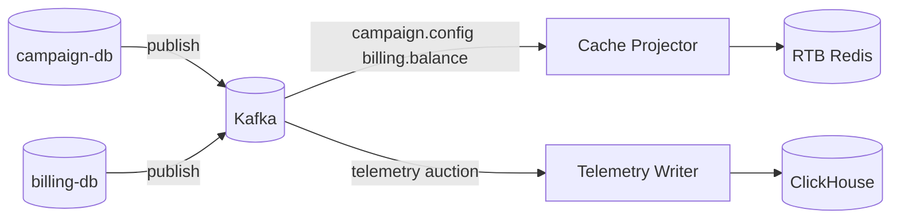

# ADR-011: CQRS — разделение write-моделей и read-проекций

**Статус**: ✅ Принято

## Контекст

Контексты AdScale имеют **разные требования к чтению и записи**:

- RTB: миллионы read/s, запись счётчиков на hot path, **без** SQL.
- Кабинет: ACID-редактирование кампаний, умеренный read.
- Биллинг: строгие транзакции записи, редкие read для UI.
- Отчётность: append-only события, тяжёлый scan/aggregate.

Попытка обслуживать все паттерны одной моделью в одной БД привела к деградации latency ([03-bounded-contexts.md](../../task1/03-bounded-contexts.md)). Kafka уже зафиксирована как шина интеграции ([ADR-004](../../task1/ADR/ADR-004-message-broker-kafka.md)).

## Рассмотренные варианты

1. **Единая нормализованная модель в PostgreSQL + синхронная репликация в Redis/CH.** Отклонено: синхронные цепочки на изменение кампании блокируют или усложняют hot path; CH не подходит как единый write store телеметрии с OLTP.
2. **Dual write: сервис кампаний пишет и в PG, и в Redis.** Отклонено: расхождения при частичных сбоях; нарушение single writer per aggregate.
3. **CQRS: write в системе-источнике истины; read-модели обновляются асинхронно через Kafka.** **Принято.**

## Решение

| Write model (источник истины)              | Read model                                         | Канал обновления                       | Потребитель read                            |
|--------------------------------------------|----------------------------------------------------|----------------------------------------|---------------------------------------------|
| `campaign-db` (кампании, лимиты, шаблоны)  | Redis: `campaign:*`, индексы кандидатов            | `campaign.config`                      | Cache Projector → RTB                       |
| `billing-db` (балансы после списания)      | Redis: `advertiser:*:balance`                      | `billing.balance`                      | Cache Projector → RTB; Campaign UI consumer |
| `campaign-db` (`spend_agg`)                | Лимиты в кабинете (PG); опционально denorm в Redis | внутренние события / `campaign.config` | Campaign API, RTB caps                      |
| Kafka `telemetry.events`, `auction.events` | ClickHouse raw + MV                                | consumers телеметрии                   | Reporting UI                                |
| —                                          | Отчёты рекламодателя                               | запросы к CH                           | Telemetry Services                          |

**Правила:**

1. **Single writer:** только Campaign API пишет домен кампаний в `campaign-db`; только Billing пишет транзакции в `billing-db`; RTB **только** инкрементирует операционные счётчики в Redis (не финальное списание).
2. **Проекции идемпотентны** по `event_id` / версии конфигурации / ключу окна `campaign.spend` ([interaction.md §7.3](../../task2/interaction.md)).
3. **Семантика агрегатов:** финансовые агрегаты расхода — только из подсистемы кампаний ([ADR-003](../../task1/ADR/ADR-003-billing-spend-aggregates-source.md)); аналитические агрегаты CH **не** используются для биллинга и лимитов.
4. **Cache warming:** при старте Projector — чтение tail compacted топиков + опциональный snapshot; RTB не принимает bid до валидного `config:version` ([bidding-service.md](../../task2/bidding-service.md)).

## Последствия

### Положительные

- Hot path изолирован от OLTP и OLAP; масштабирование read-моделей независимо.
- Явные контракты топиков вместо скрытых JOIN между контекстами.

### Отрицательные и компромиссы

- Eventual consistency: задержка между сохранением в кабинете и отражением в RTB.
- Сложность отладки «почему в Redis другое значение» — нужны версии, метрики lag, reconciliation jobs.
