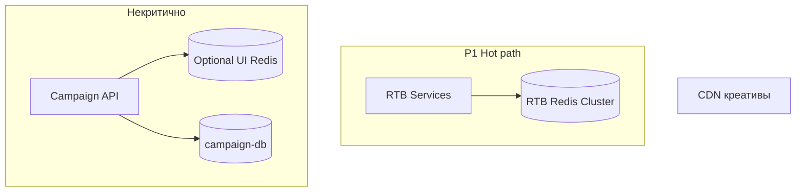

# Стратегия кэширования

Дизайн слоёв кэша, размещение Redis, TTL, инвалидация и прогрев. Связанные ADR: [ADR-006](../task1/ADR/ADR-006-rtb-in-memory-hot-path.md), [ADR-010](ADR/ADR-010-rtb-redis-isolation.md), [ADR-011](ADR/ADR-011-cqrs-projections.md).

Диаграмма: [diagrams/03-cqrs-projections.puml](diagrams/03-cqrs-projections.puml) (проекции в Redis).

---

## 1. Слои кэширования

| Слой           | Технология                 | Назначение                                                         |
|----------------|----------------------------|--------------------------------------------------------------------|
| L0 Operational | **RTB Redis Cluster**      | Торги, лимиты, кандидаты — **не** классический cache-with-fallback |
| L1 Application | Caffeine / отдельный Redis | Справочники кабинета, сессии (опционально)                         |
| L2 CDN         | CDN                        | Статика креативов, изображения                                     |

RTB Redis **физически отделён** от UI Redis ([ADR-010](ADR/ADR-010-rtb-redis-isolation.md)).

---

## 2. Что кэшировать в RTB Redis

Источник ключей: [bidding-service.md §4](../task2/bidding-service.md).

| Данные              | Ключи (примеры)                     | TTL / жизненный цикл | Инвалидация                              |
|---------------------|-------------------------------------|----------------------|------------------------------------------|
| Метаданные кампании | `campaign:{id}:meta`                | До события config    | `campaign.config` → atomic swap          |
| Правила ставок      | `campaign:{id}:bid_rules`           | Версия config        | Swap + `campaign:{id}:config_version`    |
| Лимиты и бюджеты    | `campaign:{id}:limits`              | Версия config        | Swap                                     |
| Баланс (проекция)   | `advertiser:{id}:balance`           | Event-driven         | `billing.balance`                        |
| Счётчики caps       | `campaign:{id}:counters:{yyyyMMdd}` | До конца UTC-дня     | HINCRBY; сверка с `spend_agg` асинхронно |
| Индекс кандидатов   | `idx:candidates:{segment}`          | С конфигом           | Пересборка Projector                     |
| Dedup ответа DSP    | `bid:dedup:{request_id}`            | **60 s**             | Redis TTL                                |
| Глобальная версия   | `config:version`                    | Монотонный счётчик   | Инкремент при каждом успешном swap       |

### Atomic swap (инвалидация без «полузаписанного» состояния)

1. Projector пишет во временные ключи (`*:next` или hash с суффиксом версии).
2. Lua / `RENAME` — атомарная подмена.
3. Bidding сравнивает `config_version`; при lag &gt; N секунд — **no-bid** (FR-5).

**Стратегия инвалидации:** преимущественно **write-through по событиям** (Kafka), не TTL-based eviction для доменных ключей. TTL — только для dedup и ephemeral данных.

---

## 3. Кэширование в кабинете (некритичный путь)

| Данные                        | Где              | TTL              | Инвалидация             |
|-------------------------------|------------------|------------------|-------------------------|
| Список кампаний рекламодателя | Local / UI Redis | 30–120 s         | Invalidate on write API |
| Справочник форматов           | Local            | 5–15 min         | Deploy / admin          |
| JWT/session                   | Gateway / IdP    | По политике OIDC | Logout / expiry         |

**Не кэшировать** в UI слое финальные балансы без версии — читать из PG или `billing.balance` consumer с версией `as_of_version`.

---

## 4. Размещение Redis

| Кластер             | Регион                         | Сеть        | Клиенты                                       |
|---------------------|--------------------------------|-------------|-----------------------------------------------|
| RTB Redis           | Тот же AZ/region, что RTB pods | Private VPC | Targeting, Bidding, Creative, Cache Projector |
| UI Redis (optional) | Region кабинета                | Private     | Campaign API, UI Gateway                      |

**SLO:** P95 Redis RTB ≤ 5 ms ([bidding-service.md](../task2/bidding-service.md)); colocation снижает RTT.

**Запрещено:** Kafka как замена durable cache; Redis Streams как шина ([ADR-004](../task1/ADR/ADR-004-message-broker-kafka.md)).

---

## 5. Cache warming (прогрев)

### Старт Cache Projector

1. Подключиться к consumer group `rtb-cache-projector`.
2. Для compacted топиков `campaign.config`, `billing.balance` — читать с `earliest` или последний snapshot + tail (см. [ADR-011](ADR/ADR-011-cqrs-projections.md)).
3. Применить все сообщения к Redis (идемпотентно по версии).
4. Выставить `config:version`; health = ready.

### Старт RTB сервисов

- Допускается старт до готовности Redis, но **gateway/Bidding** должны отдавать no-bid, пока `config:version` не инициализирован и метрика `projector_lag` в норме.

### После сбоя Redis

1. Поднять новый кластер.
2. Запустить Projector full replay из Kafka (retention должен покрывать окно восстановления — [ADR-014](ADR/ADR-014-rpo-rto-backup-twelve-factor.md)).
3. Опционально восстановить RDB snapshot для ускорения, затем догнать tail Kafka.

### Reconciliation (admin process, 12-Factor XII)

- Периодический job: sample 0.1% кампаний — сравнение `campaign-db` vs Redis полей limits/bid_rules.
- Расхождения → alert + принудительная публикация `campaign.config` или ручной разбор.

---

## 6. Наблюдаемость кэша

| Метрика                                         | Назначение         |
|-------------------------------------------------|--------------------|
| `redis_rtb_latency_p95`                         | SLO hot path       |
| `cache_projector_lag_seconds`                   | Свежесть проекции  |
| `config_version` / `campaign_stale_no_bid_rate` | Деградация при lag |
| `bid_dedup_hit_rate`                            | Повторы DSP        |

---

## 7. Связь с отказоустойчивостью

При недоступности Redis на hot path — **no-bid** / circuit breaker на gateway ([interaction.md](../task2/interaction.md)), не fallback в PostgreSQL.

При недоступности Kafka — ответ DSP не блокируется; проекция отстаёт; RTB продолжает работать на последнем согласованном снимке Redis до исчерпания лимитов или политики staleness.
