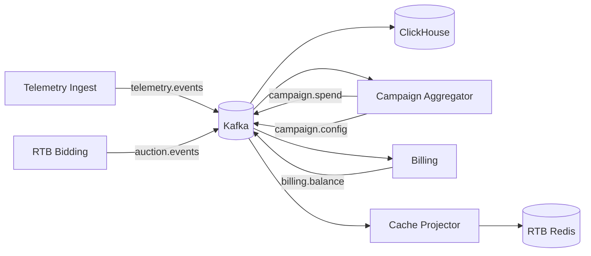

# Потоковая обработка данных (Kafka)

Архитектура event streaming: топики, схемы, consumer groups, retention и надёжность. Базовые решения: [ADR-004](../task1/ADR/ADR-004-message-broker-kafka.md), [ADR-012](ADR/ADR-012-event-schema-avro-json.md), [ADR-008](../task2/ADR/ADR-008-kafka-jitter-topic-at-least-once.md).

Диаграмма: [diagrams/04-kafka-topics-consumers.puml](diagrams/04-kafka-topics-consumers.puml).

---

## 1. Роль Kafka в платформе

- **Буфер** высокоинтенсивной телеметрии без записи в OLTP на hot path.
- **Шина интеграции** между bounded contexts (pub-sub, несколько consumer groups).
- **Транспорт CQRS** для проекций в Redis и ClickHouse ([ADR-011](ADR/ADR-011-cqrs-projections.md)).

Hot path RTB: producer **fire-and-forget** (`auction.events`) с локальным буфером при сбое брокера ([interaction.md](../task2/interaction.md)).

---

## 2. Каталог топиков

| Топик              | Содержание               | Формат   | Partition key   | Compaction |
|--------------------|--------------------------|----------|-----------------|------------|
| `telemetry.events` | Показы, клики            | **Avro** | `campaign_id`   | no         |
| `auction.events`   | bid / win / no-bid       | **Avro** | `campaign_id`   | no         |
| `campaign.config`  | Лимиты, правила, шаблоны | **JSON** | `campaign_id`   | **yes**    |
| `campaign.spend`   | Агрегаты расхода         | **JSON** | `campaign_id`   | no         |
| `billing.balance`  | Остатки, holds           | **JSON** | `advertiser_id` | **yes**    |

Технические топики на каждый бизнес-топик (где включено): `{Topic}-JitterTopic`, `{Topic}-DLQ` ([ADR-008](../task2/ADR/ADR-008-kafka-jitter-topic-at-least-once.md)).

---

## 3. Схемы событий

### Avro (`telemetry.events`)

Основные поля (эволюция через Schema Registry, совместимость BACKWARD):

| Поле            | Тип                 | Описание                    |
|-----------------|---------------------|-----------------------------|
| `event_id`      | string (UUID)       | Идемпотентность insert в CH |
| `event_time`    | long (timestamp ms) | Время события               |
| `event_type`    | enum                | impression, click, …        |
| `campaign_id`   | string              | Partition key               |
| `advertiser_id` | string              | Разрезы отчётности          |
| `creative_id`   | string              | OLAP                        |
| `cost_micros`   | long                | optional                    |
| `source`        | string              | dsp, ssp, …                 |

### Avro (`auction.events`)

| Поле             | Тип    | Описание         |
|------------------|--------|------------------|
| `event_id`       | string | Дедуп в CH       |
| `request_id`     | string | OpenRTB id       |
| `type`           | enum   | bid, win, no_bid |
| `campaign_id`    | string |                  |
| `price_micros`   | long   |                  |
| `config_version` | long   | Связь с Redis    |
| `timestamp`      | long   |                  |

### JSON envelope (config / spend / balance)

```json
{
  "schema_version": 1,
  "event_id": "550e8400-e29b-41d4-a716-446655440000",
  "occurred_at": "2026-10-02T12:00:00Z",
  "payload": { }
}
```

**`campaign.spend` payload:** `advertiser_id`, `campaign_id`, `window_start`, `window_end`, `impressions`, `clicks`, `cost_micros`, `batch_version` — ключ идемпотентности: `campaign_id + window + batch_version` ([ADR-003](../task1/ADR/ADR-003-billing-spend-aggregates-source.md)).

---

## 4. Consumer groups

| Consumer group              | Топики                               | Назначение                             | Масштабирование                 |
|-----------------------------|--------------------------------------|----------------------------------------|---------------------------------|
| `telemetry-ch-writer`       | `telemetry.events`, `auction.events` | Insert в ClickHouse                    | ≤ sum partitions                |
| `campaign-spend-aggregator` | `telemetry.events`                   | Батчи → `spend_agg` → `campaign.spend` | ≤ partitions `telemetry.events` |
| `rtb-cache-projector`       | `campaign.config`, `billing.balance` | Проекция в RTB Redis                   | 1..N (идемпотентность)          |
| `billing-deduction`         | `campaign.spend`                     | Списания в `billing-db`                | ≤ partitions                    |
| `campaign-balance-ui`       | `billing.balance`                    | Остаток в кабинете                     | 1–2                             |
| `observability-sink`        | `auction.events`                     | Метрики, FR-13                         | optional                        |

**Правило:** одна consumer group — один тип обработки; разные подсистемы **не** делят group id.

Диаграмма: [04-kafka-topics-consumers.puml](diagrams/04-kafka-topics-consumers.puml).

---

## 5. Политика хранения (retention)

| Топик              | Retention                                | Обоснование                                                                                                        |
|--------------------|------------------------------------------|--------------------------------------------------------------------------------------------------------------------|
| `telemetry.events` | **7–14 дней**                            | Переигрывание после сбоя consumer; late events; DR buffer ([ADR-014](ADR/ADR-014-rpo-rto-backup-twelve-factor.md)) |
| `auction.events`   | **3–7 дней**                             | Аналитика, расследования                                                                                           |
| `campaign.config`  | compacted, **без delete**                | Последнее состояние per key; warming Redis                                                                         |
| `campaign.spend`   | **30 дней**                              | Аудит, переобработка биллинга                                                                                      |
| `billing.balance`  | compacted + **90 дней** tombstone policy | Актуальные балансы + история для отладки                                                                           |
| `*-DLQ`            | **30 дней**                              | Ручной разбор поддержкой                                                                                           |

**Размер партиций:** мониторинг disk usage; tiered storage при росте до 50k RPS.

**Replication factor:** 3 (min.insync.replicas = 2).

---

## 6. Producers и consumers

### Producers

- `acks=all`, idempotent producer где поддерживается клиентом ([ADR-004](../task1/ADR/ADR-004-message-broker-kafka.md)).
- Telemetry Ingest: batching (linger.ms, batch.size) для throughput.
- RTB `auction.events`: короткий локальный timeout, не блокирует ответ DSP.

### Consumers

- **At-least-once:** commit offset **после** успешного side-effect (CH insert, PG transaction, Redis swap).
- Ошибка одной записи → **JitterTopic** ([ADR-008](../task2/ADR/ADR-008-kafka-jitter-topic-at-least-once.md)), не sleep в primary consumer.
- Идемпотентность: `event_id`, окна spend, `ON CONFLICT` в billing ([interaction.md §7.3](../task2/interaction.md)).

---

## 7. Потоки данных (сводка)



---

## 8. Наблюдаемость

| Метрика                             | Алерт                                           |
|-------------------------------------|-------------------------------------------------|
| `kafka_consumer_group_lag`          | Lag &gt; 10 min per group                       |
| `kafka_under_replicated_partitions` | &gt; 0 sustained                                |
| `dlq_message_rate`                  | &gt; 0 для `campaign.spend` / `billing.balance` |
| ingest publish error rate           | Рост при недоступности кластера                 |

FR-13: трассировка `request_id` / `event_id` через ingest → Kafka → CH.
